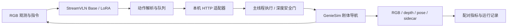
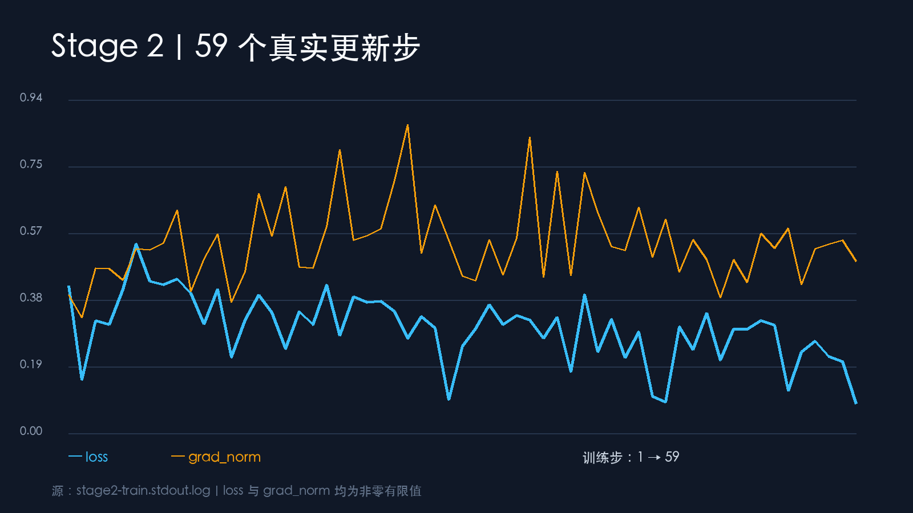

# GenieSim × StreamVLN Navigation Lab

把视觉语言模型接入机器人仿真，记录从数据、微调到闭环评测的全过程。

本项目提供 GenieSim 控制适配器、StreamVLN 数据转换与 LoRA 检查工具、同批 episode 的 Base/LoRA 评测，以及可追溯的日志、截图和失败分析。适合研究视觉语言导航系统集成、检查模型与控制器之间的接口，以及复核小规模实验结果。

**当前结果：在同一批 10 条 held-out episode 上，Base 与 LoRA 的 success@0.5m 均为 0/10。闭环运行完成，不代表导航任务成功，也没有证据表明本次微调改善了导航效果。**

[快速检查](#快速检查无需-gpu) · [实验结果](#实验结果) · [运行与复现边界](#运行与复现边界) · [文档](#文档与目录) · [许可证](#许可证与上游项目)


*历史动作与安全门演示，不是模型导航成功示例。截图、录屏和其他媒体不包含在代码的 MIT 许可内。*

## 项目包含什么

- **仿真适配器**：本机 HTTP 接口、主线程动作队列、RGB/depth/pose 记录、请求去重及路径边界检查。
- **数据链路**：3 条冒烟轨迹、50 条训练轨迹、10 条固定 held-out 的采集与验证记录；StreamVLN `annotations.json` 与完整 sidecar 分开保存。
- **训练检查**：数据检查、前后向记录、有限且非零的 loss、显存统计、新进程 adapter 重载，以及 Qwen 模板/分词器兼容处理。
- **配对评测**：同批起点与目标、模型生成动作、距离/路径/步数/动作计数，以及完整成功和失败结果。
- **实验材料**：真实观测、训练结果图、轨迹片段、过程文档和媒体制作脚本。

这不是即装即用的导航产品。机器人以刚体位姿变化导航，不包含真实人形步态控制；完整 GPU 环境、模型权重和原始数据也不随一次 `git clone` 自动就绪。

## 系统结构



动作空间固定为 `0=STOP`、`1=前进 0.25m`、`2=左转 15°`、`3=右转 15°`。Isaac 操作由主线程执行；HTTP 线程提交队列请求。服务仅监听 `127.0.0.1:5802`，不应直接暴露到公网。

## 实验结果

唯一评测指标源：[exp02-equivalent-v3/eval_result.json](aima-open-session-experiment/experiments/exp02-equivalent-v3/eval_result.json)。两组均为 `eval-2001` 至 `eval-2010`，每条最多 200 步；训练种子为 `1001–1050`。

| 指标 | Base | LoRA |
| --- | ---: | ---: |
| success@0.5m（主指标） | 0/10 | 0/10 |
| success@3m（辅助观察） | 2/10 | 1/10 |
| oracle success@0.5m | 0/10 | 0/10 |
| 当前实现的 SPL@0.5m 代理值 | 0.000 | 0.000 |
| 平均最终目标距离（m） | 3.989 | 4.686 |
| 平均最小目标距离（m） | 2.884 | 3.482 |
| 平均实际路径长度（m） | 9.675 | 5.500 |
| 平均动作步数 | 133.9 | 53.2 |
| 前进安全门拦截总数 | 132 | 45 |
| STOP / 前进 / 左转 / 右转总数 | 7 / 519 / 353 / 460 | 10 / 265 / 86 / 171 |

读表时注意：

1. success 要求发出 STOP，且最终距离不超过对应半径；oracle success 只看过程中是否曾进入该半径。
2. JSON 中的 `collisions` 记录的是安全门拒绝的前进尝试，不是接触物理碰撞次数。动作较少或拦截较少，本身不代表策略更好。
3. 当前 `SPL` 实现把初始直线距离用作最短路径代理，**不是障碍感知的 geodesic SPL**，不能直接与标准榜单比较。
4. 同一文件还保存了控制器轨迹验证：success@0.5m 为 10/10。它是控制器对照，不是模型成绩，也不证明模型获得了同等能力。
5. 只有 10 条 held-out，结果用于分析这次配置，不用于推断模型的普遍能力。`status=passed` 表示流程完成，不表示导航成功。

### 训练记录

[stage2_result_v2.json](aima-open-session-experiment/experiments/exp02-equivalent-v3/stage2_result_v2.json) 记录了 59 个更新步，loss 从 `0.4167` 降至 `0.0823`，记录的 GPU 显存峰值为 `27,846 MiB`（约 `27.19 GiB`），未记录 NaN/Inf，adapter 新进程重载通过。显存采样累加 `nvidia-smi` 返回的计算进程用量，不是模型独占显存测量。

LoRA 设置：`r=8`、`alpha=16`、dropout `0.05`、1 epoch、batch 1、学习率 `2e-5`、BF16、gradient checkpointing，`mm_tunable_parts=mm_lora_layer`。训练 loss 下降不能替代闭环评测。



*真实日志绘图，不是终端原始录屏。*

## 快速检查（无需 GPU）

以下仅验证协议、数据结构、指标、运行记录、栅格、HTTP 服务与结果组装，不启动 Isaac Sim、不下载模型。依赖 Python 标准库；本次文档核验使用 Python 3.9.6，19 个测试通过。HTTP 测试使用 `FakeBackend` 和本机临时端口。

```bash
git clone --depth 1 https://github.com/eust-w/zhiyuan.git
cd zhiyuan/aima-open-session-experiment

python3 -m unittest \
  tests.test_protocol \
  tests.test_dataset \
  tests.test_metrics \
  tests.test_manifest \
  tests.test_occupancy \
  tests.test_service \
  tests.test_assemble_eval_result -v
```

在同一目录查看保存的真实结果，并检查两组评测列表：

```bash
python3 - <<'PY'
import json
from pathlib import Path

path = Path("experiments/exp02-equivalent-v3/eval_result.json")
data = json.loads(path.read_text(encoding="utf-8"))
assert data["same_heldout_batch"]
assert data["heldout_episode_ids"] == [f"eval-{i}" for i in range(2001, 2011)]
for variant in ("base_model", "lora_model"):
    summary = data[variant]["model_evaluation"]["summary"]
    print(variant, {k: v for k, v in summary.items() if k != "episodes_detail"})
PY
```

这是**读取历史结果**，不是重新执行模型推理。`adapter.evaluate_sidecars` 计算控制器轨迹；`adapter.assemble_eval_result` 组装已有结果；真正的模型闭环入口是 `adapter.model_closed_loop_eval`。

## 运行与复现边界

历史 GPU 实验使用 GPUFree 的 NVIDIA L40 48GB、100GB 持久盘、Isaac Sim 5.1 / Python 3.11，以及单独的 StreamVLN Python 3.9 环境。不要向 Isaac Python 中直接安装整套模型训练依赖。

版本记录见 [run-manifest.json](aima-open-session-experiment/experiments/exp02-equivalent-v3/run-manifest.json)：

| 组件 | 实验版本 |
| --- | --- |
| GenieSim 预装源码 | `a04fe4f7fda0ec6e01ab652fa19094008312bf97` |
| StreamVLN 源码 | `e48f6ff7e9201d93aae003e8f64b04c00cec13bc` |
| StreamVLN real-world checkpoint | `7b0269ad28e7039a32627b950766c09b5a646f8e` |
| SigLIP | `9fdffc58afc957d1a03a25b10dba0329ab15c2a3` |

要重新运行 GPU 实验，仍须自行准备有权使用的 GenieSim/Isaac 环境、`market_00_g2` 对应场景与 G2 资产、StreamVLN 源码和权重、训练数据及 held-out sidecar。模型环境还需要 PyTorch、Transformers、PEFT、NumPy、Pillow 等依赖；仓库目前没有跨机器验证的完整依赖锁文件或一键安装器。

先读 [适配器说明](aima-open-session-experiment/adapter/README.md) 和 [实验目录入口](aima-open-session-experiment/README.md)。历史脚本中仍有 GPUFree 路径假设，需按自己的环境检查并调整，不应原样复制后就认定环境可复现。训练检查器会修改传入的 StreamVLN checkout，请使用独立副本。

### 当前已知限制

- **模型评测走的是深度安全门。** 保存的 health 标记为 `runtime_safe_fallback_no_usd_aabb`，前进安全条件为 `head_depth_center_p10_lt_0.45m`。不能把配置中的 AABB 开关当成该次评测实际采用完整 AABB 的证据。
- **完整视觉场景仍有稳定性问题。** 独立 Cube 代理层的 5cm 栅格投影探针已运行，但历史预装市场 mesh 会使完整 HTTP/Kit 进程提前退出；这两种验证不能混为一谈。
- **数据校验有边界。** 当前数据验证器的图像字节检查只检查文件非空，不等于完整 JPEG 解码。重新采集时应另做解码与抽帧检查。
- **原始资产并不完整包含在 Git 中。** 长视频、原始数据及模型相关文件不能假定随 clone 获得；历史 Release 是工作区归档，不是经许可与依赖审计的安装包。
- 本次 README 整理只复核了保存的证据和 CPU 测试，未重新租用 GPU、采集数据、训练或重跑模型评测。

## 文档与目录

```text
aima-open-session-experiment/
├── adapter/       # 协议、仿真控制、数据、训练检查、模型评测
├── configs/       # 历史场景、动作、数据与 LoRA 配置
├── tests/         # 单元测试与媒体验证测试
├── experiments/   # 运行记录、JSON 指标与日志
├── docs/          # 阶段过程与排障记录
├── scripts/       # 启动、采集、证据整理及媒体脚本
├── assets/        # 截图、动图等；不适用代码 MIT 许可
└── article/       # 长文及平台文案归档
```

| 阅读目标 | 入口 |
| --- | --- |
| 仿真与动作验证 | [Stage 0](aima-open-session-experiment/docs/01-stage0-仿真环境验证.md) |
| 数据格式与采集 | [Stage 1](aima-open-session-experiment/docs/02-stage1-数据采集.md) |
| LoRA 检查与排障 | [Stage 2](aima-open-session-experiment/docs/03-stage2-lora微调.md) |
| 模型闭环与配对评测 | [Stage 3](aima-open-session-experiment/docs/04-stage3-实时推理评测.md) |
| 失败分析 | [结果分析与排障](aima-open-session-experiment/docs/05-结果分析与排障.md) |
| 指标定义 | [metrics.py](aima-open-session-experiment/adapter/metrics.py) |
| 单条模型轨迹示例 | [Base eval-2004 GIF](aima-open-session-experiment/assets/media/v3/stage3-base-2004.gif) |

阶段文档与媒体保留了历史描述；解释指标和许可时，以本 README、原始 JSON 及 [第三方声明](THIRD_PARTY_NOTICES.md) 中的更正为准。

## 欢迎贡献

优先欢迎：完整视觉场景稳定性修复、标准 geodesic SPL、真实图像解码校验、跨机器依赖锁定，以及更大规模且不污染 held-out 的配对实验。

请在 Issue 或 PR 中写明环境、版本、可复现步骤和证据；模型改进应报告同批评测的全部结果，不只展示单条轨迹。不要上传凭据、连接信息、未经授权的模型权重或第三方资产。

## 许可证与上游项目

本项目自有源代码、测试、配置和原创文字文档采用 **[MIT License](LICENSE)**，方便学习、修改和复用。**不是仓库内所有文件都按 MIT 授权。**

训练补丁中的上游源码片段保留其适用的 Apache-2.0 / CC BY-NC-SA 4.0 条款；StreamVLN 源码的非商业条件、模型 checkpoint 的独立授权、GenieSim/Isaac 和场景条款均不会被本项目 MIT 覆盖。媒体、场景衍生物及完整 Release 归档不统一授予 MIT。详细范围与来源见 [THIRD_PARTY_NOTICES.md](THIRD_PARTY_NOTICES.md)。

感谢 [GenieSim](https://github.com/AgibotTech/genie_sim)、[StreamVLN](https://github.com/InternRobotics/StreamVLN) 及其上游贡献者。本项目与这些项目或机构没有隶属或背书关系；使用相关研究成果时，也请遵循上游的引用与署名要求。
