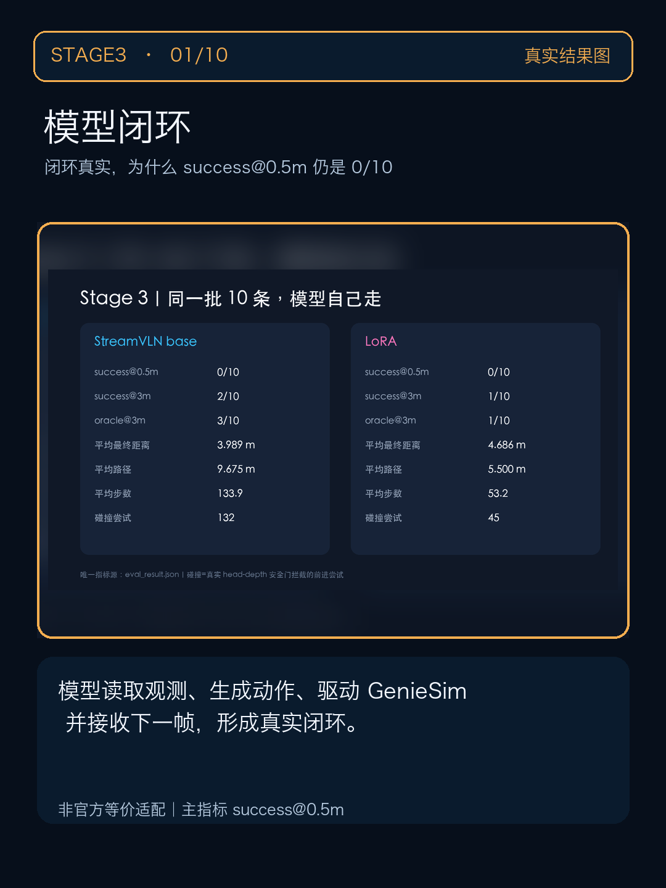
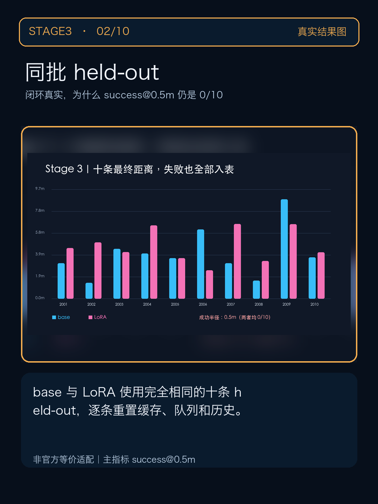
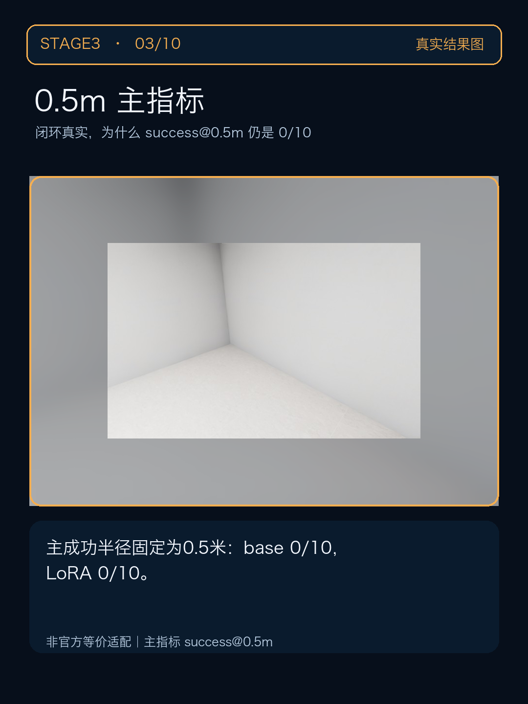
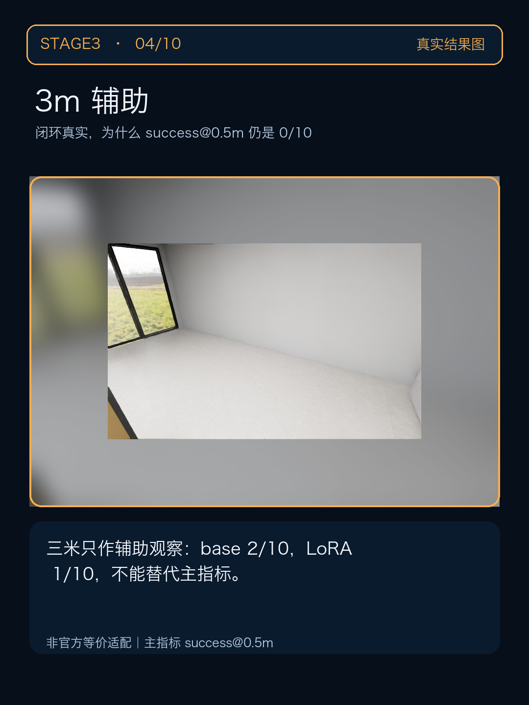
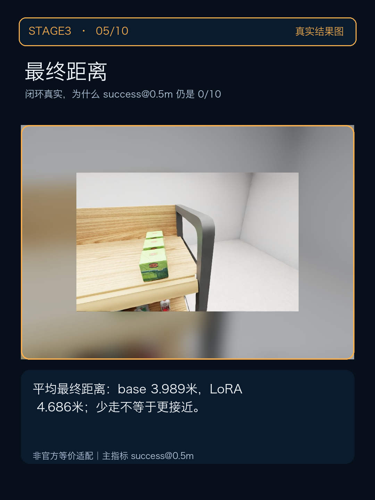
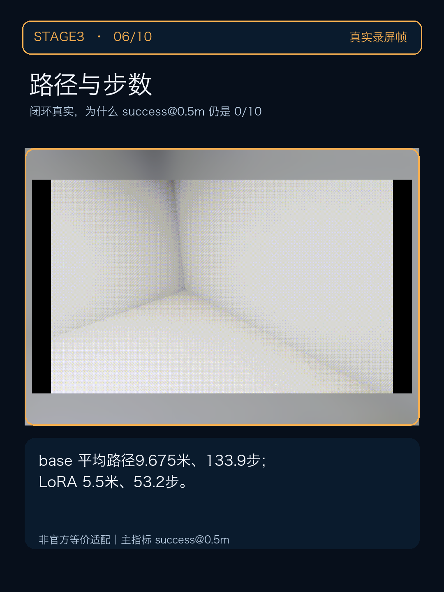
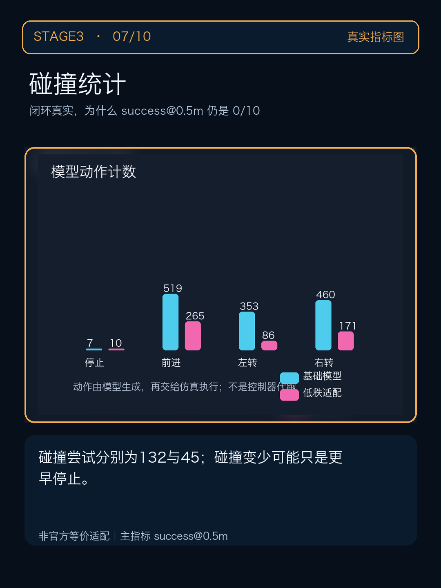
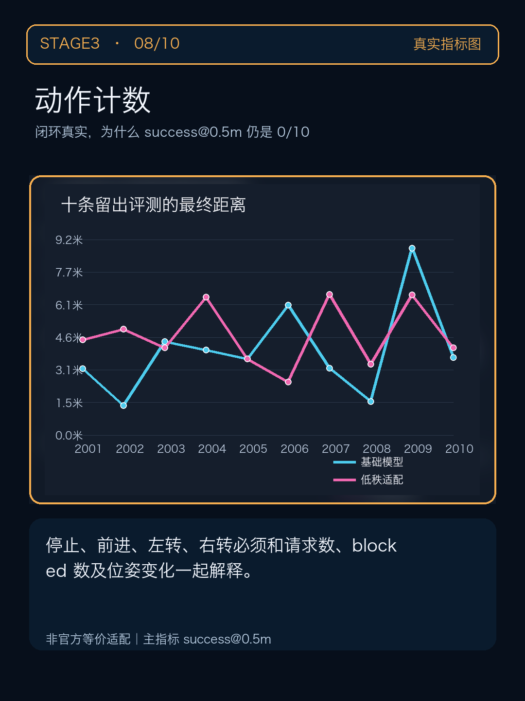
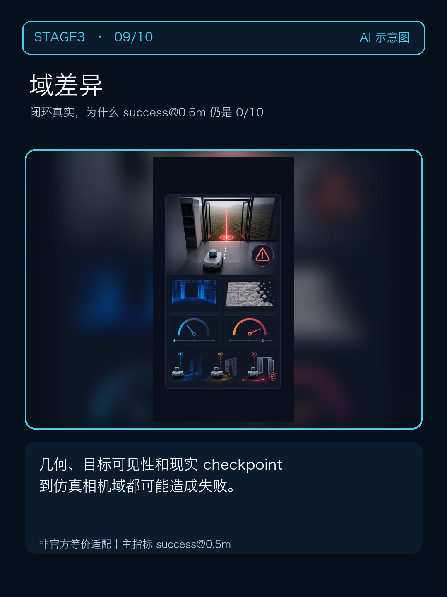
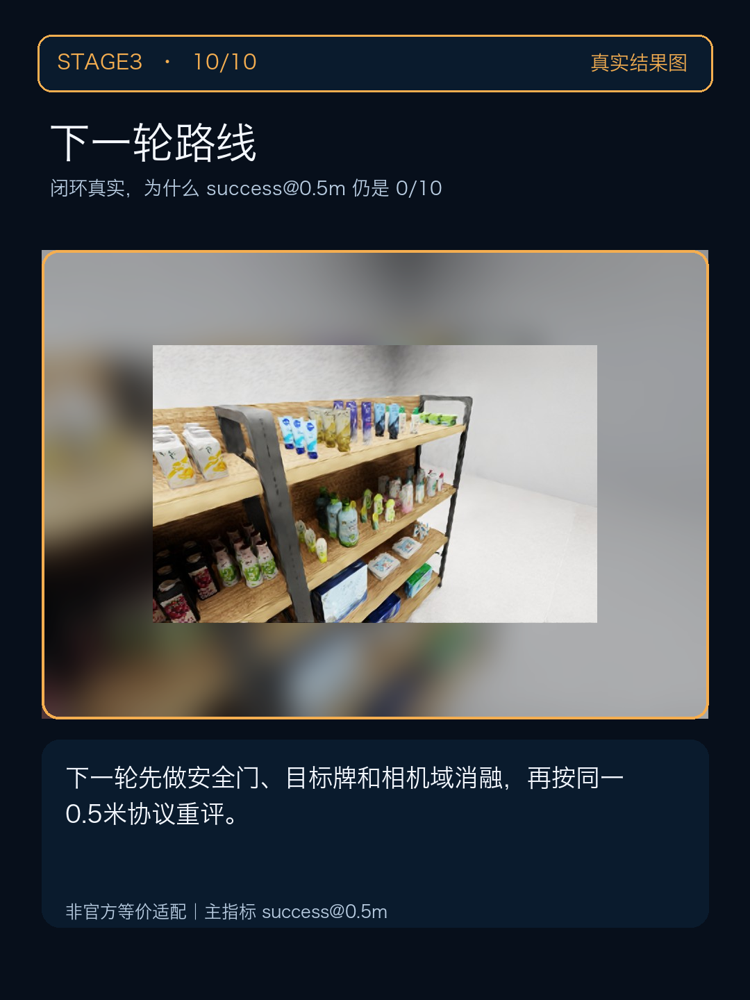

# STAGE3｜小红书步骤卡发布包

## 首图钩子

闭环真实，为什么 success@0.5m 仍是 0/10

同一批 10 条留出样本，base 和 LoRA 自己发动作，失败也完整公开。

## 8–10 张卡片顺序

1. 模型闭环

2. 同批 held-out

3. 0.5m 主指标

4. 3m 辅助

5. 最终距离

6. 路径与步数

7. 碰撞统计

8. 动作计数

9. 域差异

10. 下一轮路线

## 正文（建议 800–1000 字，发布前按最终图片微调）

今天把 闭环真实，为什么 success@0.5m 仍是 0/10 拆成一组步骤卡。开头先回答一个问题：同一批 10 条留出样本，base 和 LoRA 自己发动作，失败也完整公开。 我没有把一张漂亮的截图当成成功证据，而是把现场录屏、结果图、日志和示意图分开标注。先看第 1 张钩子图，再按动作、观测、文件、指标和复盘的顺序往下滑，每一张卡都对应一个可检查的证据点。

唯一指标源为 `eval_result.json`；主指标 success@0.5m：base 0/10，LoRA 0/10。3m 只作辅助：base 2/10，LoRA 1/10；平均最终距离分别为 3.989m 与 4.686m，碰撞尝试分别为 132 与 45。

动作层要先锁定 STOP=0、前进=1、左转=2、右转=3，并确认移动后等待两个渲染帧；数据层要同时留下 RGB、depth、pose、距离和 blocked，不能只保存一张截图。公开 annotations 只保留 StreamVLN 约定的动作数组，完整 STOP、深度、轨迹和目标信息放到 sidecar；这样既能复核，也不会污染公开格式。训练层要把 dataset-only、单批前后向、完整更新和新进程重载拆开验收；loss 下降只是训练信号，不是导航成绩。评测层固定同一批十条 held-out，success@0.5m 是主指标，3m 只做辅助；最终距离、路径、碰撞和动作数一起看，不能挑一条成功轨迹代替总体结果。

避坑清单：不要混用动作 ID；不要在动作后立刻抓图；不要把最终 STOP 塞进公开 annotations；不要用 loss 下降替代 held-out；不要把 3m 辅助结果写成 0.5m 主结果；不要把 AI 示意图当真实仿真画面。

这是非官方等价适配，不声称复制课程私有资产，也不传播私有权重。评论区想看哪一步的命令和验收截图？如果你正在复现，欢迎按‘动作安全门 / 数据 sidecar / LoRA 重载 / 配对指标’留言，我会优先补对应证据。

## 避坑清单

- 真实录屏、真实结果图、AI 示意图必须分标签。
- 主成功半径固定为 0.5m。
- 不写账号、邮箱、IP、实例 ID、SSH 或私有权重。
- 统一使用“非官方等价适配”，不宣称课程官方方案或排行成绩。

## 评论互动

你更想先看动作安全门、数据 sidecar、LoRA 重载，还是 base/LoRA 配对指标？留言后按证据文件继续补图。
