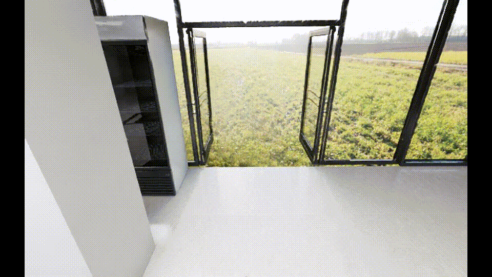
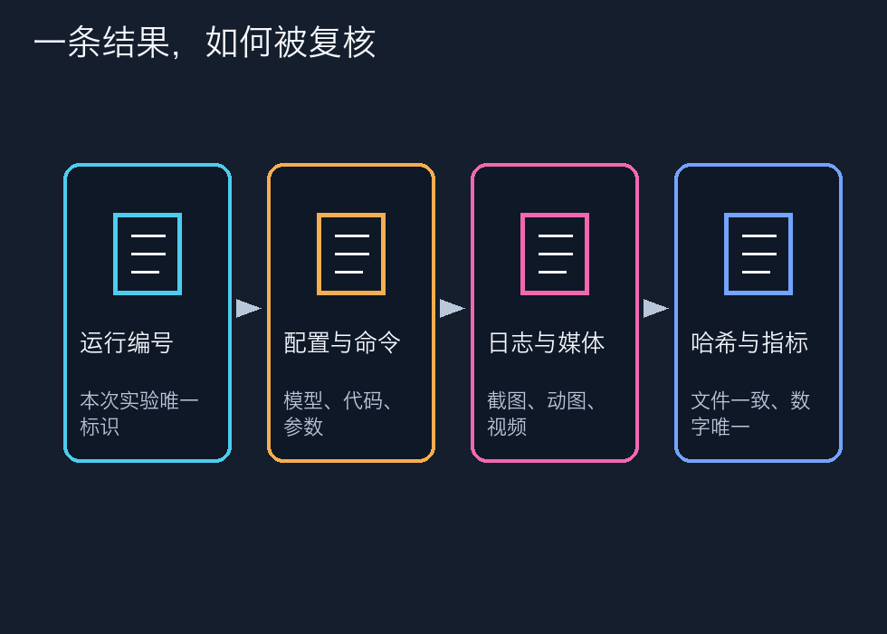
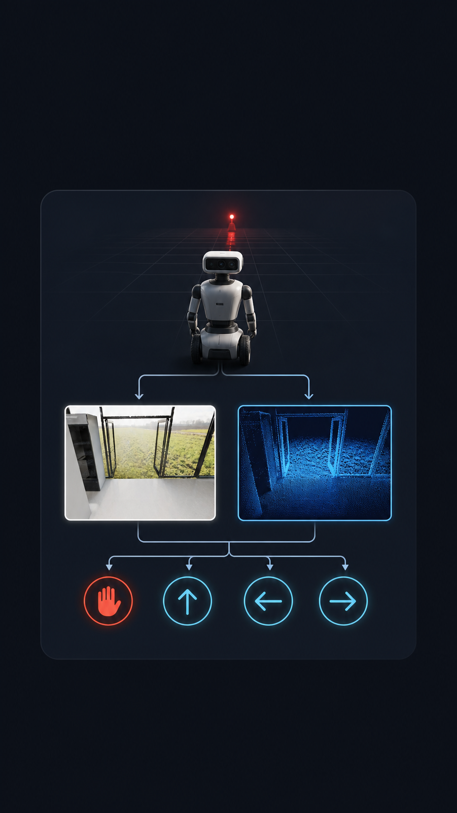
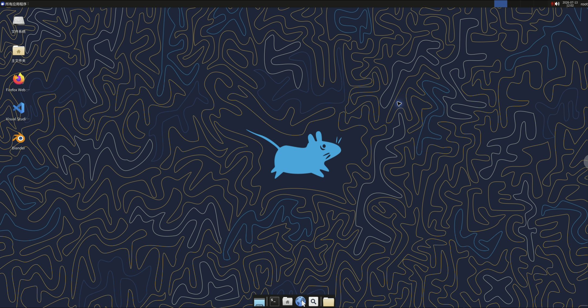
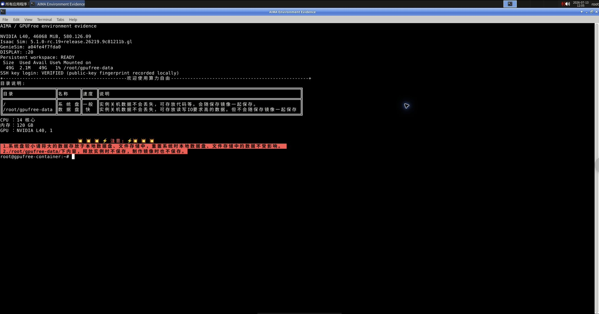

# 机器人会动，不等于导航闭环｜知乎教程草稿

> 发布前状态：草稿。统一署名“智元布道师”，统一声明为非官方等价适配。素材中的真实录屏、真实结果图和 AI 示意图会在成片与图片上分别标注。

## 开场：先别看成功率，先证明每个动作、每一帧观测和安全拒绝都可复核。

本篇不是成功案例包装，而是一份可审计的实验教程。唯一指标源为 `eval_result.json`；主指标 success@0.5m：base 0/10，LoRA 0/10。3m 只作辅助：base 2/10，LoRA 1/10；平均最终距离分别为 3.989m 与 4.686m，碰撞尝试分别为 132 与 45。 本篇只讨论 stage0 的方法和边界，3m 不替代 0.5m 主指标。

## 实验背景与边界

# 01｜Stage 0：先把仿真端验扎实

同学们，这一步先不要急着训练。Stage 0 的任务只有一个：证明场景、机器人、相机和动作链都真的在工作。流程参考 AIMA 指南，但课程私有 UDP 服务未提供，所以本实验使用独立的 loopback HTTP 适配层；它不是官方协议复刻。

## 第一步：确认你启动的是哪套环境

- 场景：GenieSim `market_00_g2`。
- 机器人：G2 Omnipicker；这里采用刚体导航代理，不宣称真实人形步态。
- 相机：头部第一视角，640×400；每次动作后至少等待两个渲染帧。
- 服务：只监听 `本机回环端口`，不开放课程未知的 12346/12347 端口。
- 训练动作：`STOP=0`、前进 0.25m、左转 15°、右转 15°。
- Stage 0 调试动作：额外允许后退 0.25m，但只走 `/v1/debug/...`，不会写入训练集。

健康检查的机器可读证据在 `stage0-health.json`。其中 `ready=true`，并明确记录 `forward_safety=head_depth_center_p10_lt_0.45m`。

## 第二步：把 W/S/A/D/Space 都按一遍

真实键盘客户端位于 `adapter/keyboard_control.py`。本轮用同一程序的非交互序列模式留下可复核 JSON，实际观察到 W、S、A、D、Space 五种键；完整记录见 `stage0-keyboard.json`。

请注意这个教学细节：S 对应的后退动作只为 Stage 0 验证服务，公开 StreamVLN 动作空间仍然严格保持 0–3，不让“调试便利”悄悄污染训练标注。

## 第三步：核对位姿增量

我们换到无遮挡朝向后执行一次 W，4×4 pose 中 XY 位移模长为 **0.25m**；原始前后观测见 `stage0-forward-check.json`。

## 第四步：验证近障碍拒绝

课程市场视觉资产在运行时做完整 USD AABB 遍历会导致当前 Isaac 进程退出，因此本项目没有假装获得课程私有障碍栅格。现已补充一个独立、可审计的等价 Cube USD 导航层，并分两层记录：

（完整阶段文档见仓库链接，发布时可继续展开命令与截图说明。）

## 按画面顺序讲解

大家好，这一集我们从最容易被忽略的地方开始：机器人会动，不等于它已经完成了导航闭环。我们参考 AIMA 技术开发指南的阶段结构，但本系列使用的是公开组件和自采的等价兼容资产，不是课程私有适配包，也不把这套流程包装成官方集成。

本集的验收目标很具体。第一，场景能够启动，G2 代理能够被定位，头部相机能够连续输出彩色图和深度图。第二，动作空间必须固定，模型只能看到 STOP、前进、左转和右转四个动作。第三，危险的前进动作要被安全门拒绝，而且拒绝以后位姿不能偷偷变化。最后，每次动作都要能和下一帧观测一一对应，之后才有资格谈数据采集和模型推理。

先看现场录屏。这里展示的是键盘验证程序，W 代表前进，S 只在 Stage 0 调试使用，A 和 D 分别代表左转和右转，Space 对应停止。进入训练动作空间以后，后退会被排除。四个模型动作的编码是固定的：STOP 等于 0，前进零点二五米等于 1，左转十五度等于 2，右转十五度等于 3。这个映射看似简单，却是后面数据标注、模型输出和适配器 API 之间最容易发生错位的地方。

为什么不能直接把键盘动作当成成功？因为键盘验证只说明控制端收到了输入。我们还要检查动作真的回到了仿真主线程，并且渲染帧、深度帧和位姿都对应同一个时间点。HTTP 线程只负责把请求放进队列，真正改变 Isaac 场景状态的动作由主线程执行。动作完成后至少等待两个渲染帧，再读取 RGB、depth、四乘四 pose、目标距离和碰撞状态。这样做是为了避免把上一帧的图像误配给当前动作。

接着看无遮挡前进。机器人向前移动零点二五米，前后位姿的平面位移模长应当接近这个数。这里我们不只看画面上机器人有没有向前，而是读取记录里的 pose 矩阵，计算 x、y 两个分量的差值。转向也采用同样的思路，十五度的增量必须在容差范围内。动作精度和画面观感是两件事，前者才是后续评测可以复核的证据。

（完整旁白脚本保留在 series/narration/，用于视频合成。）

## 读者可以照着做的验收表

| 门槛 | 通过条件 | 失败时怎么处理 |
|---|---|---|
| 环境/资产 | 场景、相机与等价资产可打开 | 先记录阻塞，不把预览当课程原件 |
| 数据/观测 | 数量、schema、RGB-D、pose 和路径检查通过 | 删除坏 episode，不能静默跳过 |
| 模型/闭环 | 日志无 NaN，动作与下一帧可追溯 | 回到对应 stage 修复，不能改指标 |
| 媒体/公开稿 | 分辨率、字幕、敏感信息扫描通过 | 标记草稿，用户确认后再投稿 |

## 证据索引（10–14 张）

图 1：`assets/screenshots/v3/stage0-validation.png`（按画面角标区分真实录屏、真实结果图与 AI 示意图）

图 2：`assets/screenshots/v3/stage0-forward-before.jpg`（按画面角标区分真实录屏、真实结果图与 AI 示意图）

图 3：`assets/screenshots/v3/stage0-forward-after.jpg`（按画面角标区分真实录屏、真实结果图与 AI 示意图）

图 4：`assets/screenshots/v3/stage0-before-block.jpg`（按画面角标区分真实录屏、真实结果图与 AI 示意图）

图 5：`assets/screenshots/v3/stage0-after-block.jpg`（按画面角标区分真实录屏、真实结果图与 AI 示意图）

图 6：`assets/media/v3/stage0-keyboard-and-guard.gif`（按画面角标区分真实录屏、真实结果图与 AI 示意图）

图 7：`assets/plots/evidence-chain.png`（按画面角标区分真实录屏、真实结果图与 AI 示意图）

图 8：`assets/ai-diagrams/ai-01-perception-action.png`（按画面角标区分真实录屏、真实结果图与 AI 示意图）

图 9：`assets/screenshots/P0-01-gpufree-desktop-browser.jpg`（按画面角标区分真实录屏、真实结果图与 AI 示意图）

图 10：`assets/screenshots/P0-02-environment-terminal.jpg`（按画面角标区分真实录屏、真实结果图与 AI 示意图）

## 失败边界与复盘

本系列把“做到了什么”和“没有做到什么”放在同一篇文章里。控制器验证只能证明动作和距离计算可工作；LoRA 的低 loss 只能证明训练信号发生；模型的真实闭环只能证明接口连通。任何一项都不能替代同批 held-out 的总体 success。课程私有适配包、原始课程 USD、私有 checkpoint 和 adapter 不随公开稿传播。

## 常见问题

**问：这是不是课程官方方案？**

答：不是。流程参考 AIMA 指南，使用公开组件和自采等价兼容资产；课程私有包和课程原始资产没有被冒充。
**问：blocked 后为什么要看 pose？**

答：只看 blocked 字段不够，拒绝前后 pose 必须一致，才能证明安全门没有偷偷改变状态。
**问：为什么要标注 AI 示意图？**

答：流程图和解释动画只帮助理解，不作为实验指标；指标只来自日志、截图和唯一 JSON 指标源。
**问：能否直接复现实验？**

答：可以按仓库文档复核公开接口和证据，但私有权重、课程私有包和外部服务不随仓库传播。
**问：下一步是什么？**

答：补齐课程等价 USD mesh、复核深度安全门和相机域，再在同一评测协议下重跑。

## 结尾互动

欢迎在评论区指出：如果你要复核这一阶段，最先会检查动作映射、数据 schema、训练重载，还是 held-out 指标？请优先讨论可复核证据，不要把示意图当原始实验画面。
