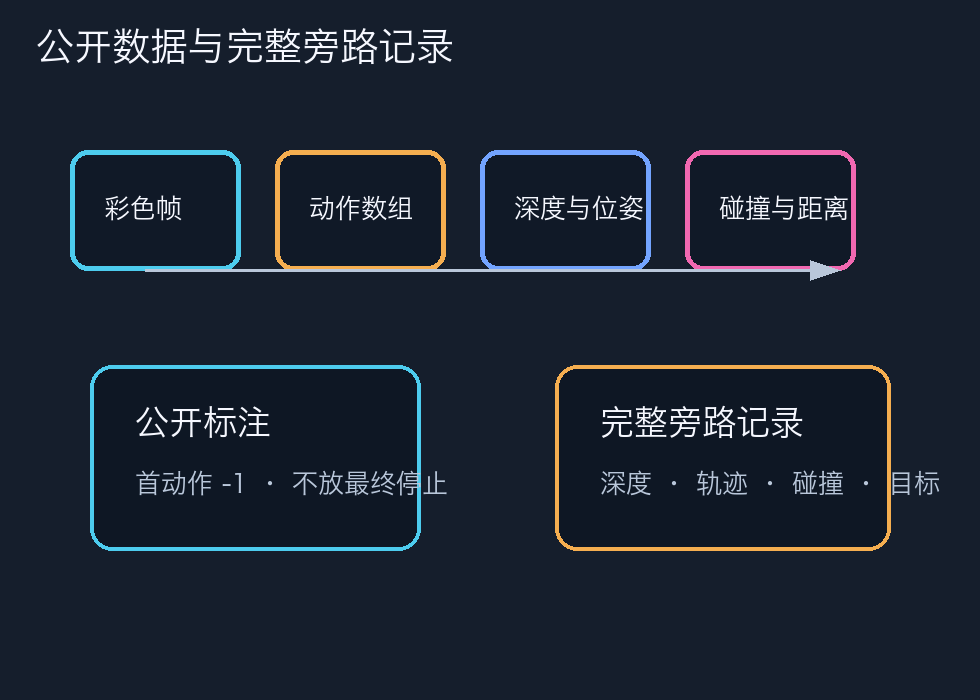
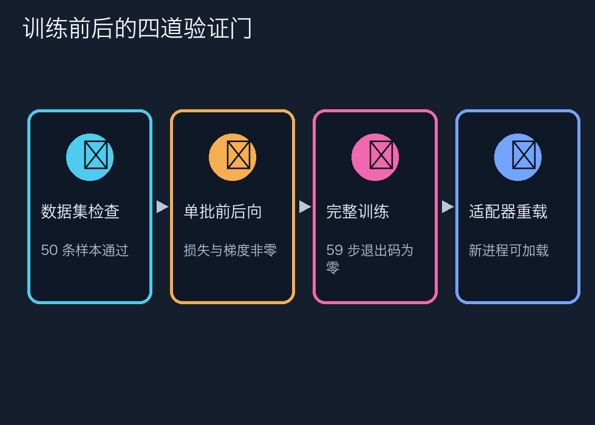
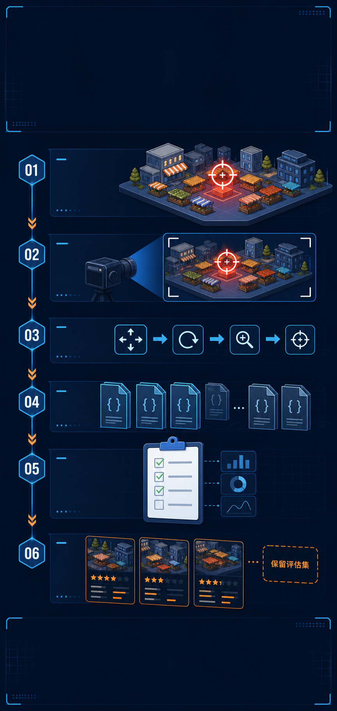
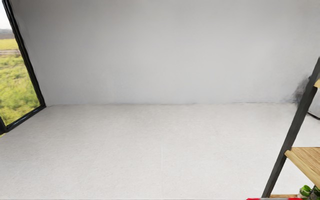

# 50 条训练与 10 条评测如何采集｜知乎教程草稿

> 发布前状态：草稿。统一署名“智元布道师”，统一声明为非官方等价适配。素材中的真实录屏、真实结果图和 AI 示意图会在成片与图片上分别标注。

## 开场：数量不是数据质量；先把同步、schema、sidecar 和几何证据分开。

本篇不是成功案例包装，而是一份可审计的实验教程。唯一指标源为 `eval_result.json`；主指标 success@0.5m：base 0/10，LoRA 0/10。3m 只作辅助：base 2/10，LoRA 1/10；平均最终距离分别为 3.989m 与 4.686m，碰撞尝试分别为 132 与 45。 本篇只讨论 stage1 的方法和边界，3m 不替代 0.5m 主指标。

## 实验背景与边界

# 02｜Stage 1：把仿真变成可训练数据

同学们，Stage 1 不是“多截几张图”，而是把每条导航过程整理成视觉、动作、语言和几何信息严格对齐的监督样本。先采 3 条冒烟轨迹，确认链路没问题，再采 50 条训练和 10 条固定评测。

## 第一步：固定数据划分

| 数据 | episode / seed | 用途 |
| --- | --- | --- |
| 冒烟 | 3 条，`3001–3003` | 尽早暴露渲染和 schema 问题 |
| 训练 | 50 条，`1001–1050` | LoRA 微调 |
| held-out | 10 条，`2001–2010` | base/LoRA 配对评测 |

50 条训练轨迹具有 50 个不同起始位姿；起点到目标优先保持在 2–6m，同一连通区域内运行。目标是在场景中运行时生成的红色目标牌。

## 第二步：理解两套数据视图

公开 `annotations.json` 遵循 StreamVLN 格式：第一项动作是 `-1`，RGB 数量与动作数组长度相同，不把最终 STOP 写入公开动作。完整 STOP、depth、4×4 pose、相机内参/外参、碰撞、目标和传感器降级字段保存在 `geniesim-streamvln/v1` sidecar。

原始 1080p/30fps 无声轨迹片段：stage1-train-1001.mp4。

## 第三步：做严格校验

机器可读结果在 `dataset-validation.json`：

```text
train: episodes=50, valid=50, invalid=0
eval:  episodes=10, valid=10, invalid=0
```

严格模式逐条检查 schema、帧/动作数、路径是否仍在实验根目录、图像是否真正可解码。最终 `dataset-v3` 有 1699 张公开 RGB，**0 张全黑帧**；仅 2 个非 STOP 观测在连续 30 个全黑渲染帧后显式复用了上一有效 RGB-D，并在 sidecar 留痕，没有把降级悄悄藏掉。

## 第四步：从同一批 RGB-D 自采等价资产

课程给出的 `sample.ply/.usda/.usdz` 私有原件无法从公开渠道取得。我们没有伪造原件，而是用 1762 帧带相机标定的 RGB-D 融合出 20 万彩色点，再从同一批点写出：

- `sample.ply`
- `sample.usda`
- `sample.usdz`

（完整阶段文档见仓库链接，发布时可继续展开命令与截图说明。）

## 按画面顺序讲解

这一集讲数据采集。很多实验在最后才发现数据不可用，原因不是模型，而是采集阶段没有把公开标注、完整旁路记录和几何证据分开。我们的目标是先完成三条冒烟轨迹，再按固定种子生成一百零一到一千零五十的五十条训练轨迹，以及两千零一到两千零一十的十条 held-out 评测轨迹。训练和评测从种子层面隔离，评测样本不参与 LoRA 更新。

每条 episode 先选择起点和目标。起点与目标必须在同一个连通区域，优先选择两到六米的距离。导航规划采用二十四方向的 SE(2) A*，方向离散化只是为了让轨迹可重复，不代表真实人形步态。目标是一个红色目标牌，成功半径固定为零点五米。三米只作为辅助观察，不能替换主指标。

实际采集时，每个时间步都会产生一组关联文件。RGB 是观测画面，depth 保存距离信息，pose 保存机器人到世界坐标的四乘四矩阵，动作记录这一步提交的动作 ID，另外还有目标距离、blocked、collision、terminated 和 truncated。动作执行以后至少等待两个渲染帧，确保文件中的编号和画面内容是同步的。采集器还要检查路径解析结果不能越过持久盘根目录，公开记录只使用相对路径。

这里有一个很容易混淆的格式边界。公开的 annotations.json 要遵循 StreamVLN 的公开格式：数组首动作写成负一，RGB 数量和动作数组保持一致，但不把最终 STOP 追加进去。完整的 STOP、depth、轨迹、目标牌信息和碰撞细节放到 geniesim-streamvln/v1 sidecar。这样既保持公开格式兼容，又不丢失仿真验收需要的完整证据。

先看一条训练样本的真实录屏。画面本身不是唯一的证据，旁边还要有写盘日志和校验结果。验收脚本逐条检查 episode 数量、首动作、帧数、动作数、目标距离、是否有 NaN、图片能否解码，以及相对路径是否仍然在实验根目录内。三条冒烟全部通过后，才开始批量采集五十条训练和十条评测。

（完整旁白脚本保留在 series/narration/，用于视频合成。）

## 读者可以照着做的验收表

| 门槛 | 通过条件 | 失败时怎么处理 |
|---|---|---|
| 环境/资产 | 场景、相机与等价资产可打开 | 先记录阻塞，不把预览当课程原件 |
| 数据/观测 | 数量、schema、RGB-D、pose 和路径检查通过 | 删除坏 episode，不能静默跳过 |
| 模型/闭环 | 日志无 NaN，动作与下一帧可追溯 | 回到对应 stage 修复，不能改指标 |
| 媒体/公开稿 | 分辨率、字幕、敏感信息扫描通过 | 标记草稿，用户确认后再投稿 |

## 证据索引（10–14 张）


图 1：`assets/screenshots/v3/stage1-validation.png`（按画面角标区分真实录屏、真实结果图与 AI 示意图）


图 2：`assets/screenshots/v3/train-1001-start.jpg`（按画面角标区分真实录屏、真实结果图与 AI 示意图）


图 3：`assets/screenshots/v3/train-1001-goal.jpg`（按画面角标区分真实录屏、真实结果图与 AI 示意图）


图 4：`assets/screenshots/v3/train-1025-mid.jpg`（按画面角标区分真实录屏、真实结果图与 AI 示意图）


图 5：`assets/screenshots/v3/train-1050-mid.jpg`（按画面角标区分真实录屏、真实结果图与 AI 示意图）


图 6：`assets/media/v3/stage1-train-1001.gif`（按画面角标区分真实录屏、真实结果图与 AI 示意图）



图 7：`assets/plots/schema-sidecar.png`（按画面角标区分真实录屏、真实结果图与 AI 示意图）



图 8：`assets/plots/validation-gates.png`（按画面角标区分真实录屏、真实结果图与 AI 示意图）



图 9：`assets/ai-diagrams/ai-02-data-pipeline.png`（按画面角标区分真实录屏、真实结果图与 AI 示意图）


图 10：`assets/screenshots/v3/eval-2001-start.jpg`（按画面角标区分真实录屏、真实结果图与 AI 示意图）



图 11：`assets/screenshots/v3/eval-2010-start.jpg`（按画面角标区分真实录屏、真实结果图与 AI 示意图）

## 失败边界与复盘

本系列把“做到了什么”和“没有做到什么”放在同一篇文章里。控制器验证只能证明动作和距离计算可工作；LoRA 的低 loss 只能证明训练信号发生；模型的真实闭环只能证明接口连通。任何一项都不能替代同批 held-out 的总体 success。课程私有适配包、原始课程 USD、私有 checkpoint 和 adapter 不随公开稿传播。

## 常见问题

**问：这是不是课程官方方案？**

答：不是。流程参考 AIMA 指南，使用公开组件和自采等价兼容资产；课程私有包和课程原始资产没有被冒充。
**问：为什么 annotations 和 sidecar 要分开？**

答：公开动作数组保持 StreamVLN 约定，完整 STOP、depth、轨迹和目标信息放旁路记录，避免格式互相污染。
**问：为什么要标注 AI 示意图？**

答：流程图和解释动画只帮助理解，不作为实验指标；指标只来自日志、截图和唯一 JSON 指标源。
**问：能否直接复现实验？**

答：可以按仓库文档复核公开接口和证据，但私有权重、课程私有包和外部服务不随仓库传播。
**问：下一步是什么？**

答：补齐课程等价 USD mesh、复核深度安全门和相机域，再在同一评测协议下重跑。

## 结尾互动

欢迎在评论区指出：如果你要复核这一阶段，最先会检查动作映射、数据 schema、训练重载，还是 held-out 指标？请优先讨论可复核证据，不要把示意图当原始实验画面。
