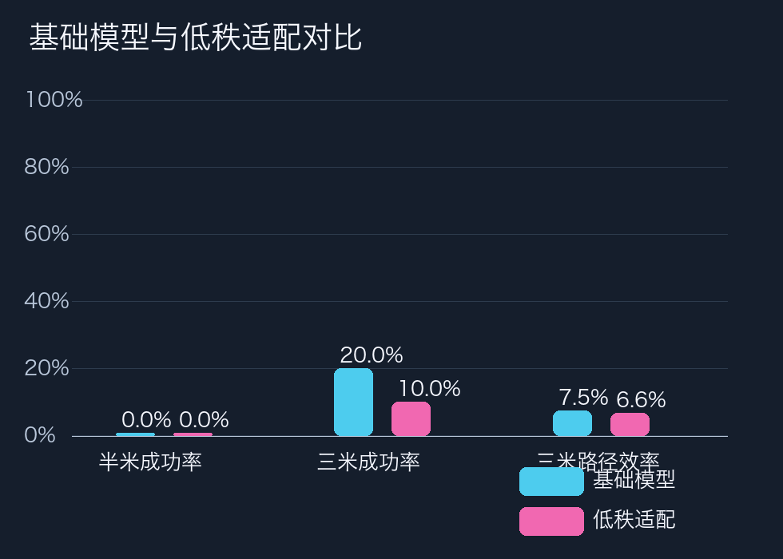
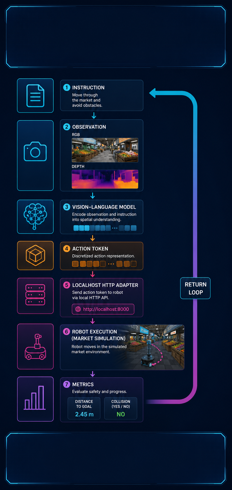
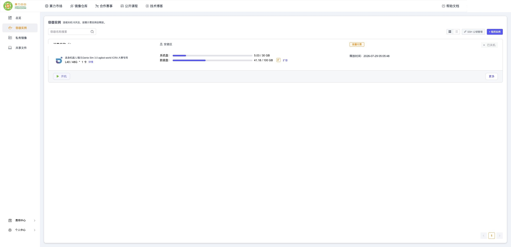

# loss 下降为什么不代表会导航｜知乎教程草稿

> 发布前状态：草稿。统一署名“智元布道师”，统一声明为非官方等价适配。素材中的真实录屏、真实结果图和 AI 示意图会在成片与图片上分别标注。

## 开场：训练曲线只能证明优化发生过；adapter 重载和闭环推理要另验。

本篇不是成功案例包装，而是一份可审计的实验教程。唯一指标源为 `eval_result.json`；主指标 success@0.5m：base 0/10，LoRA 0/10。3m 只作辅助：base 2/10，LoRA 1/10；平均最终距离分别为 3.989m 与 4.686m，碰撞尝试分别为 132 与 45。 本篇只讨论 stage2 的方法和边界，3m 不替代 0.5m 主指标。

## 实验背景与边界

# 03｜Stage 2：让 LoRA 真的发生更新

同学们，训练进程“退出码为 0”并不等于训练有效。本轮第一次运行就遇到一个很典型的陷阱：上游脚本收到不存在的 `qwen` 模板键后静默回退到 Vicuna，动作标签全部被 mask，最后 59 步 loss 和梯度都是 0。我们保留失败证据，并把“非零 loss + 非零梯度”设为硬门。

## 固定训练配置

| 参数 | 本轮值 |
| --- | --- |
| 基座 | StreamVLN real-world，固定 revision `7b0269…` |
| 视觉塔 | SigLIP，固定 revision `9fdffc…` |
| LoRA | `r=8`、`alpha=16`、dropout `0.05` |
| 训练 | 1 epoch、batch 1、LR `2e-5`、BF16 |
| 多模态 | `mm_tunable_parts=mm_lora_layer`、gradient checkpointing |
| 环境 | StreamVLN Python 3.9；Isaac Python 3.11 完全分开 |

## 第一道门：dataset-only

50/50 条训练 episode 在加载模型前先通过严格检查，避免花 GPU 时间训练坏数据。

## 第二道门：单 batch 前后向

正确模板键改为公开代码真实存在的 `qwen_2`；同时用 token 字符串解析 `<|im_start|>` 与 `<|im_end|>`，避免把“额外 special token 数量恰好等于 2”当成前提。独立单批次结果：

```text
loss       = 0.4167
grad_norm  = 0.3836
peak VRAM  ≈ 22.47 GiB
NaN / Inf  = false
```

只有这一步通过，完整训练才会启动。

## 第三道门：完整训练

训练证据动图：stage2-training-evidence.gif；1080p/30fps 无声片段：MP4。

完整训练实际记录 **59 个更新步**，首步 loss `0.4167`，末步 `0.0823`，最大 grad_norm `0.8733`，峰值显存约 `27.19GiB`，没有 OOM、NaN 或 Inf。训练 loss 下降只说明模型拟合了这批数据，不能替代仿真成功率。

## 第四道门：新进程重载

训练结束后另起 Python 3.9 进程，用 PEFT 将 adapter 挂载到基座，重载通过。adapter 文件 SHA-256 为：

（完整阶段文档见仓库链接，发布时可继续展开命令与截图说明。）

## 按画面顺序讲解

这一集我们讨论训练。标题里的问题是：loss 下降，为什么仍然不能说模型会导航？答案是训练指标和闭环指标测量的是不同对象。loss 只说明给定输入和标签时，优化器找到了一组更低的数值；它没有告诉我们模型在仿真里能不能理解目标、能不能选择安全动作，也没有告诉我们动作送回适配器后会发生什么。

先说环境隔离。Isaac Sim 使用预装的 Python 三点十一运行时，StreamVLN 的训练环境单独放在持久盘的 Python 三点九环境里。两个环境不能互相覆盖依赖。我们先锁定官方 Transformers 四点四五点一并验证 checkpoint 加载；只有在加载失败时，才按确定性规则升级到四点五一点零，并把最终依赖记录在 run-manifest。这样可以避免“为了能跑起来”临时改包，却无法解释结果来自哪套环境。

LoRA 配置是固定的：秩 r 等于八，alpha 等于十六，dropout 为零点零五，训练一轮，批量大小一，学习率二乘十的负五次方，BF16，开启 gradient checkpointing，并设置 mm_tunable_parts 等于 mm_lora_layer。这些值不是效果保证，而是复现实验的边界。视频里的配置卡只展示参数，真正的训练结果仍然来自日志和 JSON。

训练前先做 dataset-only 检查。它验证公开 annotations 能否读取、首动作是不是负一、图像路径是否存在、帧数与动作数组是否一致、sidecar 是否能够关联。然后做单 batch 前向和反向，检查输出、loss、梯度都不是 NaN 或 Inf。单 batch 通过后才开始完整训练，否则直接继续跑五十九步只会浪费时间和显存。

这次完整日志里有五十九个真实、有限且非零的更新步，loss 从零点四一六七下降到零点零八二三，峰值显存约二十七点一九 GiB。曲线说明优化过程发生过，但它没有证明模型理解“走向红色目标”这句话，更没有证明它能在新的相机观测里找到目标。我们把训练证据和导航证据分开放，就是为了不让一条漂亮的曲线替代真实闭环。

（完整旁白脚本保留在 series/narration/，用于视频合成。）

## 读者可以照着做的验收表

| 门槛 | 通过条件 | 失败时怎么处理 |
|---|---|---|
| 环境/资产 | 场景、相机与等价资产可打开 | 先记录阻塞，不把预览当课程原件 |
| 数据/观测 | 数量、schema、RGB-D、pose 和路径检查通过 | 删除坏 episode，不能静默跳过 |
| 模型/闭环 | 日志无 NaN，动作与下一帧可追溯 | 回到对应 stage 修复，不能改指标 |
| 媒体/公开稿 | 分辨率、字幕、敏感信息扫描通过 | 标记草稿，用户确认后再投稿 |

## 证据索引（10–14 张）


图 1：`assets/screenshots/v3/stage2-gates.png`（按画面角标区分真实录屏、真实结果图与 AI 示意图）


图 2：`assets/screenshots/v3/stage2-loss-curve.png`（按画面角标区分真实录屏、真实结果图与 AI 示意图）


图 3：`assets/media/v3/stage2-training-evidence.gif`（按画面角标区分真实录屏、真实结果图与 AI 示意图）


图 4：`assets/plots/lora-config.png`（按画面角标区分真实录屏、真实结果图与 AI 示意图）



图 5：`assets/plots/metrics-base-lora.png`（按画面角标区分真实录屏、真实结果图与 AI 示意图）



图 6：`assets/ai-diagrams/ai-03-closed-loop.png`（按画面角标区分真实录屏、真实结果图与 AI 示意图）


图 7：`assets/screenshots/v3/stage1-validation.png`（按画面角标区分真实录屏、真实结果图与 AI 示意图）


图 8：`assets/screenshots/v3/stage3-paired-metrics.png`（按画面角标区分真实录屏、真实结果图与 AI 示意图）


图 9：`assets/screenshots/v3/stage3-episode-distances.png`（按画面角标区分真实录屏、真实结果图与 AI 示意图）



图 10：`assets/screenshots/v3/final-instance-powered-off.jpg`（按画面角标区分真实录屏、真实结果图与 AI 示意图）

## 失败边界与复盘

本系列把“做到了什么”和“没有做到什么”放在同一篇文章里。控制器验证只能证明动作和距离计算可工作；LoRA 的低 loss 只能证明训练信号发生；模型的真实闭环只能证明接口连通。任何一项都不能替代同批 held-out 的总体 success。课程私有适配包、原始课程 USD、私有 checkpoint 和 adapter 不随公开稿传播。

## 常见问题

**问：这是不是课程官方方案？**

答：不是。流程参考 AIMA 指南，使用公开组件和自采等价兼容资产；课程私有包和课程原始资产没有被冒充。
**问：loss 下降是不是成功？**

答：不是。loss 只说明优化发生过，adapter 重载和导航闭环必须单独验收。
**问：为什么要标注 AI 示意图？**

答：流程图和解释动画只帮助理解，不作为实验指标；指标只来自日志、截图和唯一 JSON 指标源。
**问：能否直接复现实验？**

答：可以按仓库文档复核公开接口和证据，但私有权重、课程私有包和外部服务不随仓库传播。
**问：下一步是什么？**

答：补齐课程等价 USD mesh、复核深度安全门和相机域，再在同一评测协议下重跑。

## 结尾互动

欢迎在评论区指出：如果你要复核这一阶段，最先会检查动作映射、数据 schema、训练重载，还是 held-out 指标？请优先讨论可复核证据，不要把示意图当原始实验画面。
