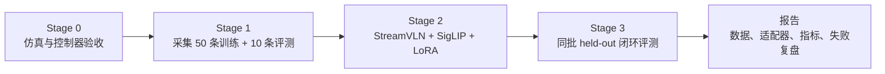
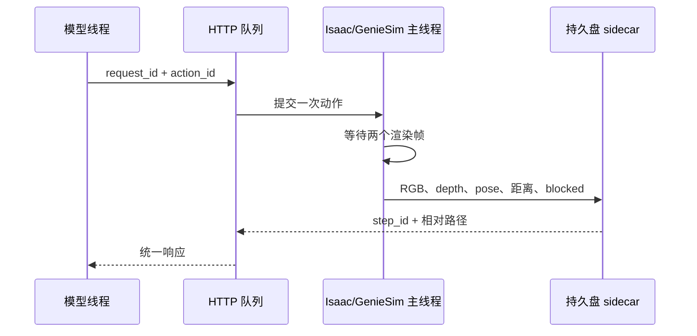
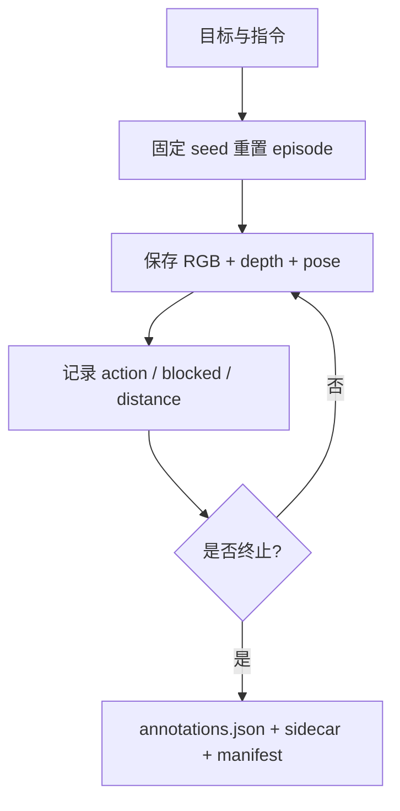
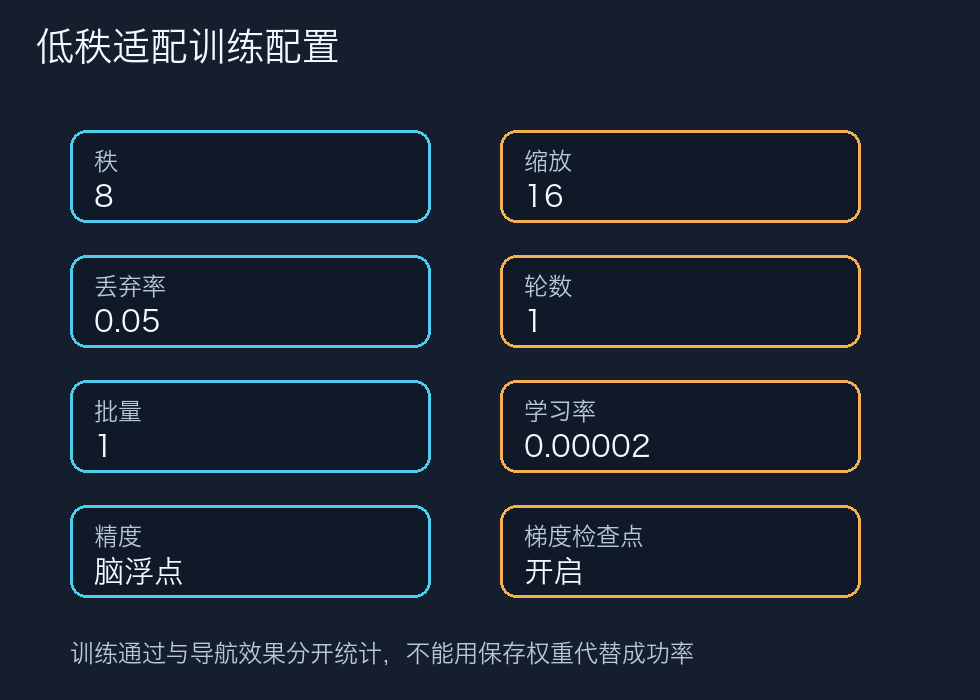
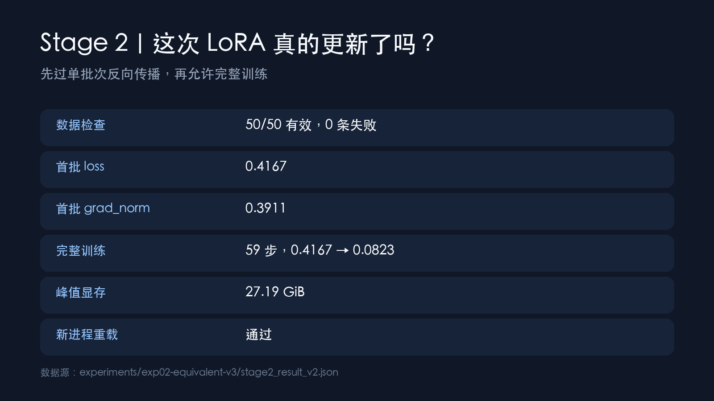
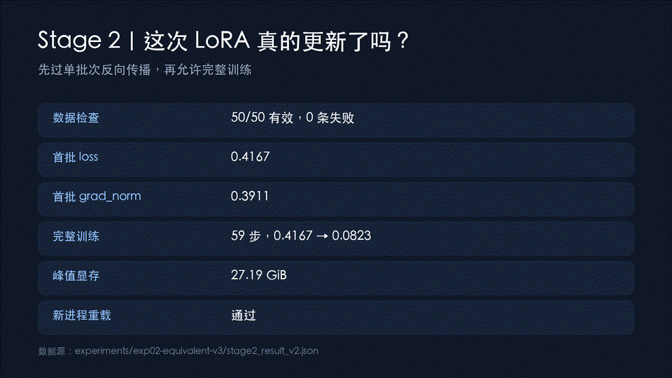
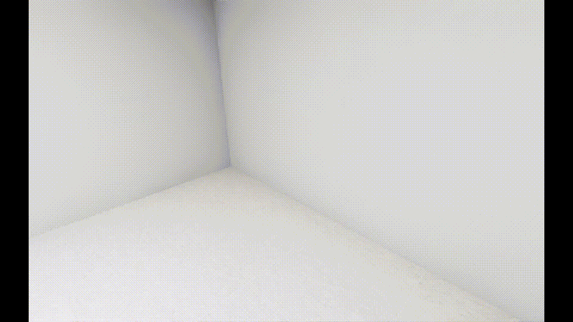
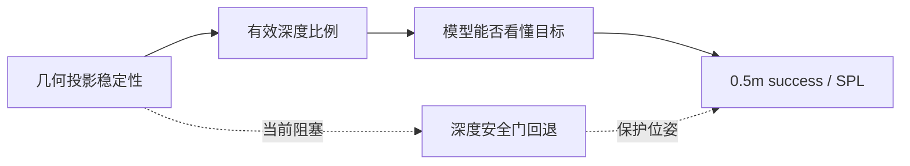

# 从一句指令到一条真实轨迹：GenieSim × StreamVLN 非官方等价闭环经验

> **文章定位**：面向希望复现实验流程、理解具身智能评测边界的读者，完整记录一次参考 AIMA 技术开发指南的 GenieSim × StreamVLN 适配。文中包含真实截图、真实 GIF/视频、训练日志和同批留出评测指标。
>
> **重要声明**：本项目没有使用课程私有适配包，也没有把结果提交到 AgiBot Open Session 榜单；使用的是公开模型与自采集的等价兼容资产，导航后端是碰撞感知的刚体 G2 代理，不代表真实人形步态，也不构成官方集成。

## 先给结论：闭环跑通了，但模型没有越过 0.5 米成功线

这次实验把一条英文导航指令送进 StreamVLN，再让模型自己输出离散动作，动作经过本机适配接口进入 GenieSim，仿真返回新的彩色图、深度、位姿和距离，直到模型停止或达到步数上限。基础模型和低秩适配都在**同一批 10 条 held-out episode** 上完成了这条闭环。

最终结果很诚实：

| 版本 | success@0.5m | success@3m | oracle success@3m | 平均最终距离 | 平均路径 | 平均步数 | 安全门拦截 |
|---|---:|---:|---:|---:|---:|---:|---:|
| 基础模型 | 0/10 | 2/10 | 3/10 | 3.989 m | 9.675 m | 133.9 | 132 |
| LoRA | 0/10 | 1/10 | 1/10 | 4.686 m | 5.500 m | 53.2 | 45 |

这里的“碰撞”是前进动作被近障碍安全门拒绝的次数，不是把机器人真的穿进货架。主指标固定采用 **0.5 m**，与当前实验验收口径一致；3 m 只作为辅助观察，不能替代主指标。

唯一指标源是 [`experiments/exp02-equivalent-v3/eval_result.json`](../experiments/exp02-equivalent-v3/eval_result.json)。文章里的数字都从这个文件读取，不手工挑选“最好看的一条轨迹”。

## 1. 我到底在复现什么？先把“课程流程”和“当前实现”分开

PDF 指南可以概括成四个阶段：

课程原流程里有私有场景资产、课程工具和 UDP 接口；当前机器上无法取得这些私有包，所以本轮采用“**流程等价、资产自采、接口独立、边界公开**”的做法：

| PDF 中的环节 | 本轮落地 | 关系 |
|---|---|---|
| `sample.ply / sample.usdz / sample.usda` | 自采集 RGB-D 生成的等价 PLY/USDA/USDZ，加上 `market-aabb-proxy.usda` | 等价资产，不是课程原件 |
| `course_tools` 采集器 | 独立采集器与 sidecar 记录 | 接口独立 |
| UDP 12346 / 12347 | 本机回环 HTTP 适配器 | 避免冒充课程协议 |
| 课程场景 | `market_00_g2` + 红色目标标记 | 场景语义相近 |
| 成功半径 | 0.5 m 主指标 | 本轮固定口径 |
| Open Session 提交 | 不提交 | 公开页面是模型部署榜单，与本地 episode 协议不兼容 |

这张表不是“降级说明”，而是复现实验最重要的第一步：先说明哪些是原样，哪些是等价，哪些暂时没有实现。

## 2. 环境准备：算力、持久盘和线程边界

实验运行在 GPUFree 的 L40 48GB 实例上，使用 100GB 持久盘保存源码、数据、媒体和运行清单。Isaac Sim 使用自己的 Python 3.11 运行时；StreamVLN 单独使用持久盘内 Python 3.9 环境，避免训练依赖污染仿真进程。

准备阶段只做三类检查：

1. GPU、Isaac Sim、Genie Sim 和远程桌面可用；
2. 持久盘可写，并且所有输出路径解析后仍在实验根目录内；
3. SSH 公钥登录可用，但账号、地址、实例编号和私密连接信息不写入公开文章。

### 为什么 HTTP 只监听本机？

适配器只监听本机回环地址。HTTP 线程不直接驱动 Isaac Sim，而是把请求放入队列，由仿真主线程执行动作和渲染；每次移动后至少等待两个渲染帧，再保存观测。这样可以避免“接口已经返回，但画面还是上一帧”的隐蔽错位。

## 3. Stage 0：先证明控制器和观测是可信的

动作空间固定为四个动作：

| action_id | 含义 | 增量 |
|---:|---|---:|
| 0 | STOP | 结束当前 episode |
| 1 | FORWARD | 0.25 m |
| 2 | TURN_LEFT | 15° |
| 3 | TURN_RIGHT | 15° |

后退只用于键盘冒烟，不进入训练动作空间。W/S/A/D/Space 都先做手工验证；无遮挡时前进位姿应改变，遇到近障碍时动作应被拒绝，拒绝后位姿保持不变。

真实动作回放：

原始视频：[1080p/30fps 无声片段](../assets/media/v3/stage0-keyboard-and-guard.mp4)。

### 深度安全门的实际含义

课程私有的 USD AABB 工具无法直接使用，公开市场 mesh 还会触发预装 Kit 提前退出。因此运行时采用可审计的回退：读取头部深度图中央区域的第 10 百分位，如果小于 0.45 m，就拒绝前进。它不是完整三维碰撞体，文章里明确称为“深度安全门”，不把它写成课程原样的障碍投影器。

## 4. Stage 1：数据采集不是“拍 60 张图”

采集顺序是：先跑 3 条冒烟，再固定种子采集训练集 `1001–1050` 和评测集 `2001–2010`。起点与目标必须在同一可达区域，距离优先落在 2–6 m 之间。每个时间步至少保存：

- RGB 图像；
- depth 数组；
- 4×4 位姿矩阵；
- 当前动作、阻塞和碰撞结果；
- 目标 ID、目标坐标、目标距离；
- episode seed、相机内参和运行编号。

公开 `annotations.json` 保持 StreamVLN 兼容：首动作是 `-1`，RGB 数量与动作数组一致，不把最终 STOP 写进公开数组。完整 STOP、depth、轨迹和目标信息写入 `geniesim-streamvln/v1` sidecar。

这一步最终得到 50 条训练轨迹、10 条 held-out 评测轨迹，共 1762 帧带标定 RGB-D；同时生成约 20 万点的等价 PLY/USDA/USDZ 资产并在新 Isaac 进程打开验证。

## 5. 等价 USD 资产：为什么还要单独做 AABB 探针

为了不把“完整视觉进程提前退出”误写成“没有做三维障碍投影”，另做了一个最小化 PXR/Isaac 探针：把 10 个 Cube 的 AABB 投影到 5 cm 占据栅格，再按机器人 footprint 加 5 cm 膨胀。

探针的真实事件记录显示：

- 10 个 Cube；
- 原始占据格 8322；
- 膨胀后占据格 30478；
- 障碍高度筛选 0.10–1.80 m；
- footprint 半尺寸 0.34 m × 0.28 m；
- 膨胀半径 10 个栅格单元。

完整事件见 [`evidence/aabb-standalone7-events.txt`](../evidence/aabb-standalone7-events.txt)，代理资产见 [`artifacts/equivalent-scene/market-aabb-proxy.usda`](../artifacts/equivalent-scene/market-aabb-proxy.usda)。

这说明等价资产的几何投影路径是可验证的，但当前视觉 HTTP 进程仍受预装市场 mesh 的 Kit 提前退出影响，所以模型历史评测使用的是深度安全门回退，而不是把探针结果冒充完整视觉闭环。

## 6. Stage 2：LoRA 训练通过四道门，不能直接等同于导航成功

LoRA 配置固定为：

| 参数 | 值 |
|---|---:|
| rank `r` | 8 |
| alpha | 16 |
| dropout | 0.05 |
| epoch | 1 |
| batch size | 1 |
| learning rate | 2e-5 |
| dtype | BF16 |
| gradient checkpointing | 开启 |
| `mm_tunable_parts` | `mm_lora_layer` |

训练不是“一条命令跑完就算成功”，而是依次通过：

1. dataset-only：只读数据集，确认样本、路径和 schema；
2. 单 batch 前后向：确认 loss 和梯度都是有限数；
3. 完整训练：保存 loss、更新步数和峰值显存；
4. adapter reload：新进程加载适配器，确认目录和权重可读。

最终训练产生 59 个有限的非零更新步，loss 从 0.4167 降到 0.0823，峰值显存约 27.19 GiB，无 NaN/Inf，新进程重载通过。训练 GIF 和原始视频：

[1080p/30fps 无声训练片段](../assets/media/v3/stage2-training-evidence.mp4)。

这里能证明的是“训练确实发生、adapter 能被重载”，不能证明“模型已经学会在新场景里导航”。这也是为什么 Stage 3 必须独立做同批配对评测。

## 7. Stage 3：基础模型和 LoRA 真的自己发动作

每个 episode 都会重置 KV cache、动作队列和历史记忆，最大 200 步；非法模型输出安全转换为 STOP。模型看到观测后，只能输出 STOP、前进、左转、右转，适配器返回下一帧，再进入下一次推理。

同一条轨迹的原始回放：[1080p/30fps 无声片段](../assets/media/v3/stage3-base-2004.mp4)。

### 为什么要把控制器成绩和模型成绩分开？

控制器验证 10/10@0.5m，只能说明起点、目标、动作执行和距离计算能够工作；模型评测 0/10@0.5m，说明在同样的仿真接口上，模型动作还没有把机器人带到目标附近。把前者写成后者，会直接破坏实验可信度。

基础模型有 2/10 达到 3 m，LoRA 有 1/10 达到 3 m；但两者在 0.5 m 主指标上都是 0/10。LoRA 的平均步数和安全门拦截次数下降，并不等于导航质量更好，因为平均最终距离从 3.989 m 变成 4.686 m。

## 8. 失败复盘：失败发生在哪里？

这次失败不是一句“模型不行”就结束，而是拆成三层：

### 8.1 几何层

完整 USD 场景的市场 mesh 在 Kit 进程里不稳定，AABB 投影不能直接作为 HTTP 运行时的唯一安全依据。最小代理资产的 PXR 探针已通过，但仍需把稳定的几何投影接回真正的视觉进程。

### 8.2 感知层

头部深度输入存在无效值，因此需要中央区域第 10 百分位的回退安全门。它能降低危险前进，但不是完整 occupancy grid，也无法替代真实深度/障碍投影。

### 8.3 模型层

LoRA 训练曲线下降，adapter 也能重载，但目标相关数据规模有限，且场景和模型真实世界 checkpoint 之间仍有域差异。训练通过不等于策略能在新场景正确闭环。

## 9. 证据链：让别人能复核，而不是只能相信文章

每次运行生成唯一 `run_id` 和 `run-manifest.json`，记录源码/模型修订、配置、命令、开始结束时间、退出码、数据与媒体哈希。媒体目录保存截图、GIF 和 MP4；指标只从 `eval_result.json` 读取。

推荐复核顺序：

1. 先看 [Stage 0 近障碍安全门](../docs/01-stage0-仿真环境验证.md)；
2. 再看 [Stage 1 数据 schema 与轨迹](../docs/02-stage1-数据采集.md)；
3. 再看 [Stage 2 四道训练验证门](../docs/03-stage2-lora微调.md)；
4. 最后看 [Stage 3 同批 base/LoRA 评测](../docs/04-stage3-实时推理评测.md)；
5. 用 [PDF 逐项验收与等价说明](../docs/07-PDF逐项验收与等价说明.md)核对哪些地方是原样、等价或未完成。

## 10. 和课程要求的关系：完成了实验链路，不等于完成了原课程私有环境

当前状态应该这样表述：

- **已完成**：Stage 0–3 的独立等价闭环；50 条训练轨迹、10 条固定留出评测；LoRA 训练与新进程重载；base/LoRA 同批模型推理；指标、截图、GIF、视频、运行清单和失败复盘。
- **等价完成**：兼容 USD/PLY/USDA/USDZ 资产、5 cm 占据栅格探针、红色目标、四动作映射、loopback HTTP 适配器。
- **仍不等价**：课程私有 `sample.*` 原件、`course_tools`、课程 UDP 12346/12347、课程原始场景和 Open Session 提交。

所以标题应写“非官方等价适配”或“流程复盘”，不能写“官方适配”“课程原样复现”或“榜单成绩”。

## 11. 下一轮怎么做？按影响排序，而不是继续堆截图

1. **先稳定三维资产**：把已验证的 AABB 代理几何接回视觉 HTTP 进程，解决 Kit 提前退出；
2. **再提高深度有效率**：补齐相机深度的有效像素、单位和裁剪范围，逐步移除回退安全门；
3. **最后补目标相关数据**：增加不同距离、朝向和遮挡条件下的红色目标样本；
4. **保持同批回归**：继续使用 `eval-2001…2010`，同时报告 0.5 m 主指标和 3 m 辅助指标；
5. **重新核对授权**：StreamVLN 仓库、checkpoint 和 adapter 的许可证目前没有完成独立法律确认，基础权重和 adapter 不进入仓库、不再分发。

## 12. 结语：失败率为零，仍然可以是有价值的实验

如果只看“有没有成功”，这次结果是 0/10；如果看“闭环是否真实”，它已经完成了模型读取观测、生成动作、调用适配器、驱动仿真、保存下一帧并汇总指标的完整链路。

真正值得复用的经验不是一张成功截图，而是三条底线：

1. **先把控制器、观测和指标验收清楚**；
2. **训练通过和模型成功必须分开写**；
3. **课程原样、等价实现和未完成项要在文章里显式标注**。

这份记录希望让下一轮实验少走弯路：先补几何与感知，再谈模型成绩；先保证证据链，再谈对外传播。

## 相关素材

- [55 秒沉稳男声视频](../assets/videos/douyin-vln-retrospective-55s-voiceover.mp4)
- [20 张中文轮播图](../assets/carousel/)
- [实验总览 README](../README.md)
- [运行日志](../runs/2026-07-13/session-log.md)
