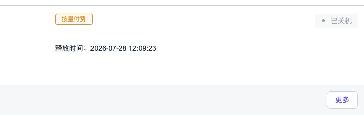

# 00｜准备、资源与安全

## 目标

建立可复现且不会泄露账号、SSH 或平台凭据的实验环境。

## 已验证资源

| 项目 | 当前结果 |
| --- | --- |
| GPU | NVIDIA L40，约 46GB 可用显存 |
| 计算实例 | GPUFree L40 按量计费实例；阶段运行后必须关机 |
| SSH | 本机 ED25519 公钥免密登录成功 |
| Isaac Sim | `5.1.0-rc.19+release.26219.9c81211b.gl`；Python 3.11.13 |
| Genie Sim | `/root/genie_sim`；commit `a04fe4f7fda0ec6e01ab652fa19094008312bf97` |
| 远程桌面 | `DISPLAY=:20`，1920×1080，Selkies 视频链路已连接 |
| 持久化盘 | `/root/gpufree-data`，扩容到 100GB |
| 实验工作区 | `/root/gpufree-data/zhiyuan-aima` |

## 课程资源边界

PDF 引用的课程私有脚本、`course_tools` 与 `sample.*` 未公开；本实验因此只实现独立的公开接口适配，不称为课程原样复现。

## 安全规则

1. 只记录“公钥认证已验证”，不记录私钥内容、完整公钥或连接命令。
2. 截图不得包含登录密码、身份证、实例密码、Token、Cookie 或完整连接凭据。
3. 所有 Open Session Tunnel Endpoint、UUID 和 Token 只作为运行时环境变量存在。
4. 原始录屏先放 `assets/videos/raw/`，脱敏后再引用。
5. 每阶段结束即把数据盘证据同步本地；释放实例前再次核验。

## 持久化目录

```text
/root/gpufree-data/zhiyuan-aima/
├── workspace/
├── evidence/{screenshots,gifs,videos,raw}/
├── logs/
├── checkpoints/
├── runs/
└── cache/{hf,torch,conda,ov}/
```

Isaac Sim 缓存 `/root/.cache/ov` 已指向数据盘内的 `cache/ov`。模型、训练数据、检查点与媒体不得写入 30GB 系统盘。

## 证据

### P0-01｜GPUFree 图形桌面


证明 Selkies 远程桌面已连接到实例图形会话，可用于后续 Isaac Sim 截图和录屏。画面未包含 IP、实例 ID、密码或 Token。

### P0-02｜脱敏环境验证


证明 L40、驱动、Isaac Sim、Genie Sim commit、`DISPLAY=:20`、100GB 持久盘和 SSH 公钥登录均已就绪。截图只声明公钥认证已验证，不展示公钥正文或连接地址。

## 已知限制

- 镜像不含 `rsync`，因此小型证据文件改用 SSH/SCP 同步；原因与替代路径均已验证。
- Isaac Sim Python 3.11 与 StreamVLN Python 3.9 分离；StreamVLN 依赖只写入数据盘环境。
- GPUFree 镜像不含课程私有适配包；精确检索边界见 [课程资产检索与限制](06-课程资产检索与阻塞记录.md)。

### P9-01｜等待资源期间停止计费



页面状态已从“运行中”变为“已关机”。截图只保留计费方式、状态和自动释放时间，裁掉了实例 ID、连接入口与账号区域。
