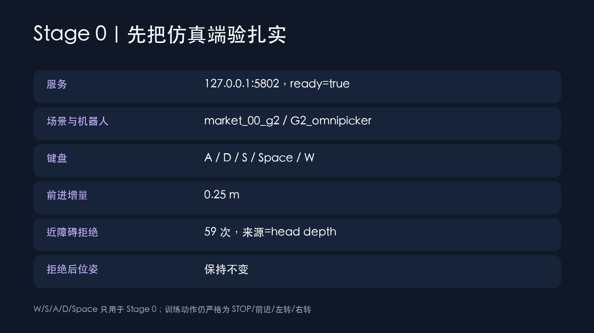
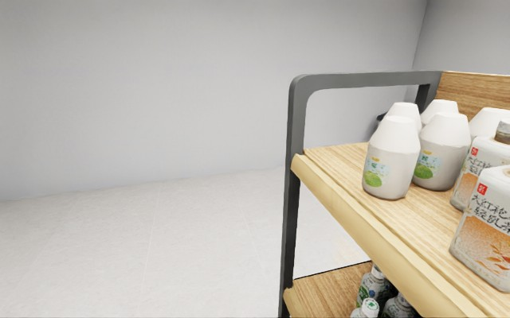
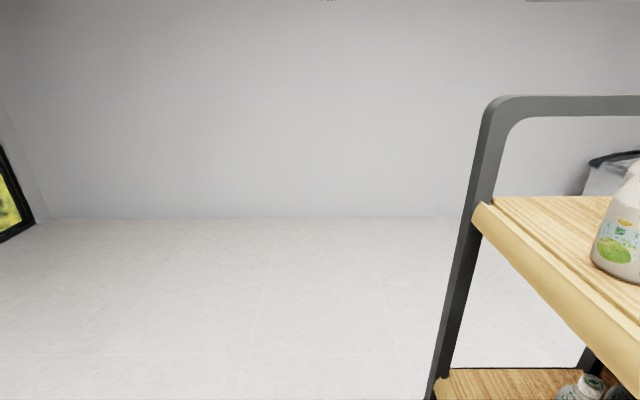
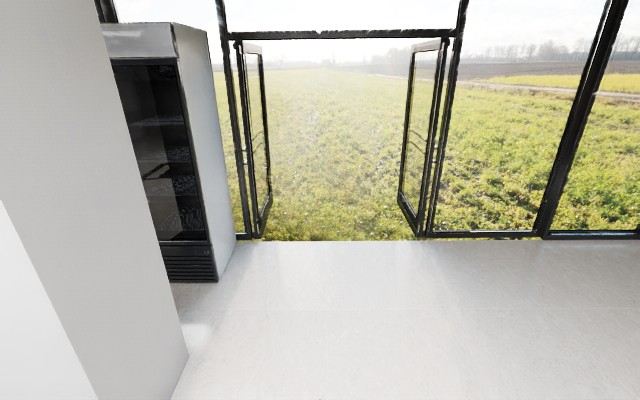
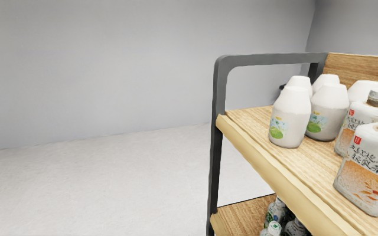

# 01｜Stage 0：先把仿真端验扎实

同学们，这一步先不要急着训练。Stage 0 的任务只有一个：证明场景、机器人、相机和动作链都真的在工作。流程参考 AIMA 指南，但课程私有 UDP 服务未提供，所以本实验使用独立的 loopback HTTP 适配层；它不是官方协议复刻。

## 第一步：确认你启动的是哪套环境

- 场景：GenieSim `market_00_g2`。
- 机器人：G2 Omnipicker；这里采用刚体导航代理，不宣称真实人形步态。
- 相机：头部第一视角，640×400；每次动作后至少等待两个渲染帧。
- 服务：只监听 `127.0.0.1:5802`，不开放课程未知的 12346/12347 端口。
- 训练动作：`STOP=0`、前进 0.25m、左转 15°、右转 15°。
- Stage 0 调试动作：额外允许后退 0.25m，但只走 `/v1/debug/...`，不会写入训练集。

健康检查的机器可读证据在 [`stage0-health.json`](../experiments/exp02-equivalent-v3/stage0-health.json)。其中 `ready=true`，并明确记录 `forward_safety=head_depth_center_p10_lt_0.45m`。

## 第二步：把 W/S/A/D/Space 都按一遍

真实键盘客户端位于 `adapter/keyboard_control.py`。本轮用同一程序的非交互序列模式留下可复核 JSON，实际观察到 W、S、A、D、Space 五种键；完整记录见 [`stage0-keyboard.json`](../experiments/exp02-equivalent-v3/stage0-keyboard.json)。

请注意这个教学细节：S 对应的后退动作只为 Stage 0 验证服务，公开 StreamVLN 动作空间仍然严格保持 0–3，不让“调试便利”悄悄污染训练标注。

## 第三步：核对位姿增量

我们换到无遮挡朝向后执行一次 W，4×4 pose 中 XY 位移模长为 **0.25m**；原始前后观测见 [`stage0-forward-check.json`](../experiments/exp02-equivalent-v3/stage0-forward-check.json)。

## 第四步：验证近障碍拒绝

课程资产在运行时做完整 USD AABB 遍历会导致当前 Isaac 进程退出，因此本项目没有假装获得课程私有障碍栅格。替代方案分两层：

1. 有界安全栅格负责 footprint 越界保护；`/health` 诚实标为 `runtime_safe_fallback_no_usd_aabb`。
2. 真实头部 depth 的中央 40%×50% 区域使用第 10 百分位距离；小于 0.45m 时拒绝前进。

本轮连续前进测试得到 **59 次真实 depth 安全门拒绝**，`blocked_source=head_depth_forward_guard`，每次被拒绝后位姿矩阵保持不变。

动图证据：[W/S/A/D 与安全门 GIF](../assets/media/v3/stage0-keyboard-and-guard.gif)；原始 1080p/30fps 无声片段：[MP4](../assets/media/v3/stage0-keyboard-and-guard.mp4)。

这里的“碰撞”是安全门拦截到的碰撞尝试，不是先撞上再回退。这个区别在 Stage 3 的碰撞统计里同样成立。

## 本阶段结论

Stage 0 的 W/S/A/D/Space、0.25m 前进、15° 转向、RGB/depth、近障碍拒绝和拒绝后位姿不变均有真实记录。仍需保留的边界是：障碍来源为头部 depth 加安全边界，不是课程私有 USD AABB 实现。
