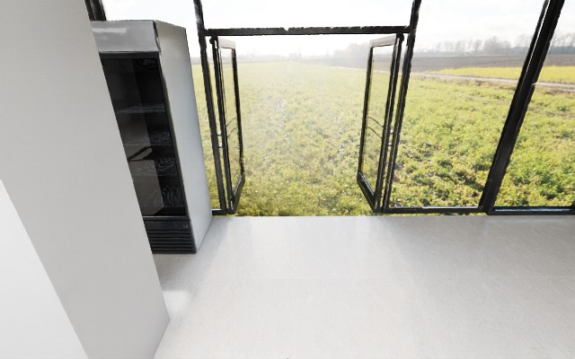

# 01｜Stage 0：仿真环境验证

状态：已完成 loopback 服务与传感器验证；真实 USD AABB 障碍投影受引擎稳定性阻塞。

## 实际配置

- 场景：`market_00_g2`，公开 GenieSim USD `market_2/background.usda`。
- 机器人：G2 Omnipicker；头部相机 640×400、30fps。
- 动作：`STOP=0`、前进 `0.25m=1`、左转 `15°=2`、右转 `15°=3`。
- 服务：仅监听 `127.0.0.1:5802`，HTTP 线程把动作排队到 Isaac 主线程。
- 每次 reset/step 后等待两个渲染帧，再写 JPEG、depth NPY、4×4 pose 和碰撞字段。

## 真实证据

```text
GET  /health                         -> ready=true
POST /v1/episodes/reset              -> 0000.jpg + 0000.npy
POST /v1/episodes/smoke-0001/step   -> 0001.jpg + 0001.npy
重复 request_id smoke-r1            -> 返回相同 step_id=1，不重复动作
POST /v1/episodes/smoke-0001/close  -> closed=true, steps=1
```




## 栅格限制

配置原本会从 USD AABB 生成 5cm 栅格并做 footprint+5cm 膨胀。当前 GPUFree 资产在 `UsdGeom.BBoxCache` 遍历时触发 SimulationApp clean shutdown，无法得到可审计的 AABB 结果；为保持运行可复现，`project_usd_aabbs=false` 使用以起点为中心的有界空闲栅格，并在 `/health` 标记 `runtime_safe_fallback_no_usd_aabb`。因此本阶段不能宣称已验证真实障碍拒绝。

## 媒体

- [5 帧控制器 GIF](../assets/gifs/stage1-smoke-controller.gif)
- [竖屏复盘 MP4](../assets/videos/stage1-smoke-retrospective-vertical.mp4)

## 结论

公共场景、G2 头部相机、渲染帧等待、幂等 HTTP 合同和媒体写入均已真实跑通；真实 USD 障碍栅格与键盘 W/S/A/D/Space 尚未取得可公开成功证据，不能把 fallback 数据当作碰撞导航结论。
