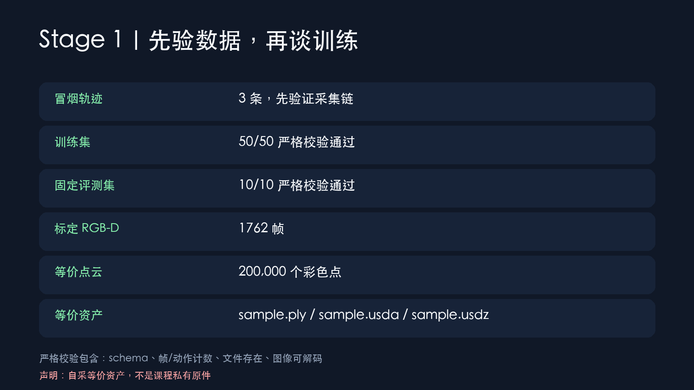
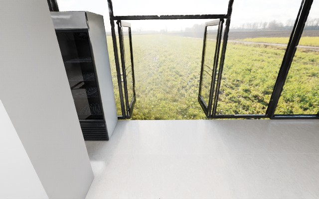
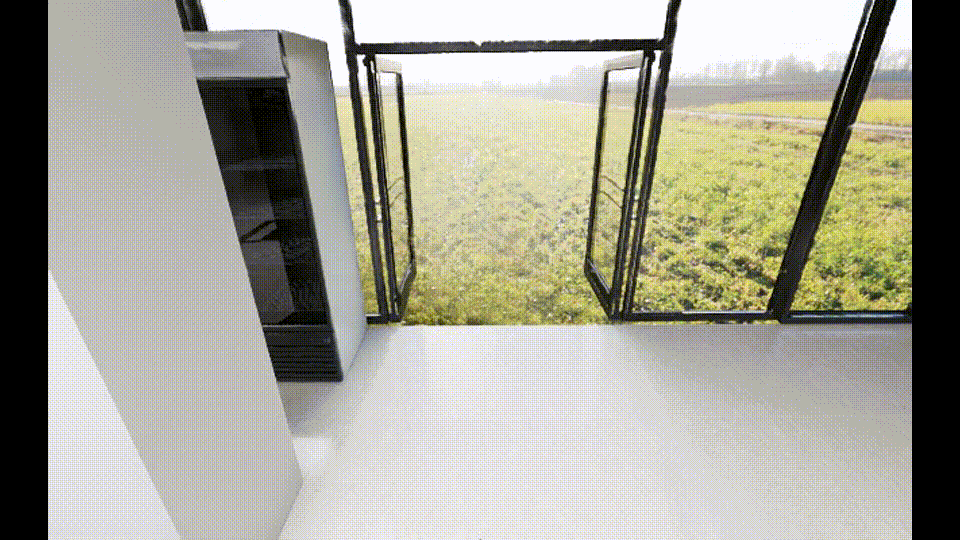

# 02｜Stage 1：把仿真变成可训练数据

同学们，Stage 1 不是“多截几张图”，而是把每条导航过程整理成视觉、动作、语言和几何信息严格对齐的监督样本。先采 3 条冒烟轨迹，确认链路没问题，再采 50 条训练和 10 条固定评测。



## 第一步：固定数据划分

| 数据 | episode / seed | 用途 |
| --- | --- | --- |
| 冒烟 | 3 条，`3001–3003` | 尽早暴露渲染和 schema 问题 |
| 训练 | 50 条，`1001–1050` | LoRA 微调 |
| held-out | 10 条，`2001–2010` | base/LoRA 配对评测 |

50 条训练轨迹具有 50 个不同起始位姿；起点到目标优先保持在 2–6m，同一连通区域内运行。目标是在场景中运行时生成的红色目标牌。

## 第二步：理解两套数据视图

公开 `annotations.json` 遵循 StreamVLN 格式：第一项动作是 `-1`，RGB 数量与动作数组长度相同，不把最终 STOP 写入公开动作。完整 STOP、depth、4×4 pose、相机内参/外参、碰撞、目标和传感器降级字段保存在 `geniesim-streamvln/v1` sidecar。






原始 1080p/30fps 无声轨迹片段：[stage1-train-1001.mp4](../assets/media/v3/stage1-train-1001.mp4)。

## 第三步：做严格校验

机器可读结果在 [`dataset-validation.json`](../experiments/exp02-equivalent-v3/dataset-validation.json)：

```text
train: episodes=50, valid=50, invalid=0
eval:  episodes=10, valid=10, invalid=0
```

严格模式逐条检查 schema、帧/动作数、路径是否仍在实验根目录、图像是否真正可解码。最终 `dataset-v3` 有 1699 张公开 RGB，**0 张全黑帧**；仅 2 个非 STOP 观测在连续 30 个全黑渲染帧后显式复用了上一有效 RGB-D，并在 sidecar 留痕，没有把降级悄悄藏掉。

## 第四步：从同一批 RGB-D 自采等价资产

课程给出的 `sample.ply/.usda/.usdz` 私有原件无法从公开渠道取得。我们没有伪造原件，而是用 1762 帧带相机标定的 RGB-D 融合出 20 万彩色点，再从同一批点写出：

- `sample.ply`
- `sample.usda`
- `sample.usdz`

三份文件均在新 Isaac 进程中重新打开，默认 prim 与 200,000 个点均通过验证。清单和 SHA-256 在 [`asset-capture-manifest.json`](../artifacts/equivalent-scene/asset-capture-manifest.json)，固定声明为 `geniesim-self-captured-equivalent/v1`，不能冒充课程原件。

## 本阶段结论

3 条冒烟、50 条训练、10 条 held-out、严格校验和等价资产都已完成。这里证明的是“采集链可训练、可复核”；控制器能到目标不等于 StreamVLN 模型也能到，真正模型成绩只看 Stage 3。
