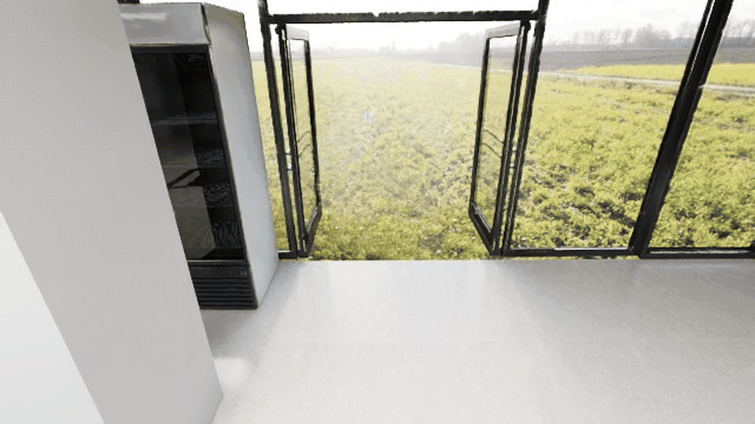

# 02｜Stage 1：StreamVLN 数据采集

状态：已完成 3 条冒烟、50 条训练和 10 条评测采集；数据来自明确标注为 fallback 的确定性控制器。

## 数据配置

| 字段 | 值 |
| --- | --- |
| 场景 | `market_00_g2` |
| 目标 | 运行时生成的红色目标牌 `red-target-marker` |
| 训练 seeds | `1001–1050`（50 条） |
| 评测 seeds | `2001–2010`（10 条） |
| 指令 | 训练 5 个英文模板；评测 2 个未见英文改写 |
| 公共动作 | 首项 `-1`，随后 `1/2/3`；不写最终 STOP |
| sidecar | `geniesim-streamvln/v1`，含完整 STOP、depth、pose、碰撞与目标信息 |

## 实际结果

远端采集日志记录每条轨迹 26 个非 STOP 动作，最终距离 `0.4800000259m`，STOP 后 `terminated=true`。训练和评测 annotation 均严格通过：

```text
train: episodes=50, valid=50, invalid=0
eval:  episodes=10, valid=10, invalid=0
```

每条公开 episode 的 RGB 数量与 `[-1, actions…]` 长度一致；完整轨迹另存 sidecar，避免把 STOP 混入公开动作数组。




## 复核方法

```bash
PYTHONPATH=aima-open-session-experiment \
python3 -m adapter.collect_dataset --split train --start-seed 1001 --count 50
```

采集器只调用 loopback HTTP，不导入 Isaac；它复制响应中的 RGB/depth 到 `dataset/{split}/{episode}/`，并为每条 episode 写 `dataset/sidecar/{episode}.json`。如果服务返回错误或文件不在实验根目录内，采集立即失败。

## 限制

由于占据栅格为安全 fallback，本批数据只证明接口、帧/动作对齐和可达目标闭环，不证明真实障碍环境下的碰撞感知导航质量；若要发布成绩，必须先恢复兼容的 USD AABB 投影并重新采集。
