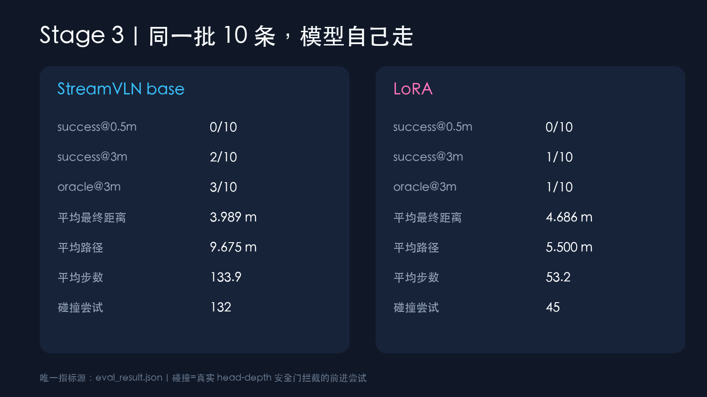
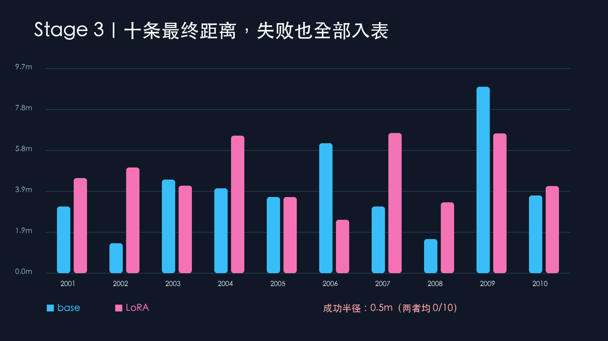
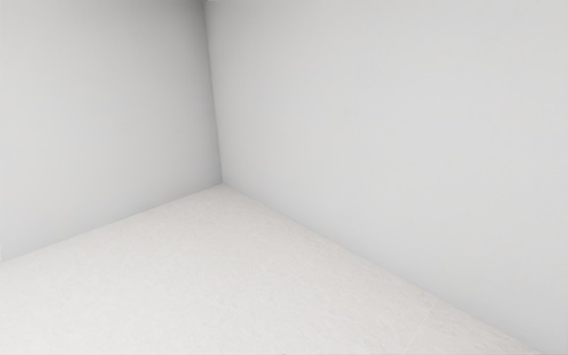
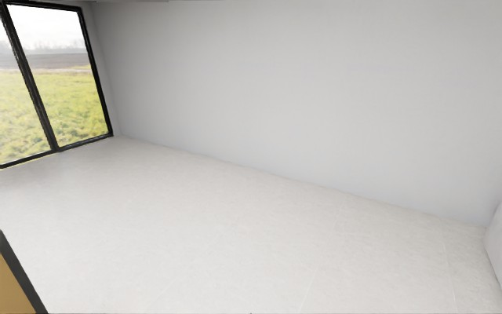
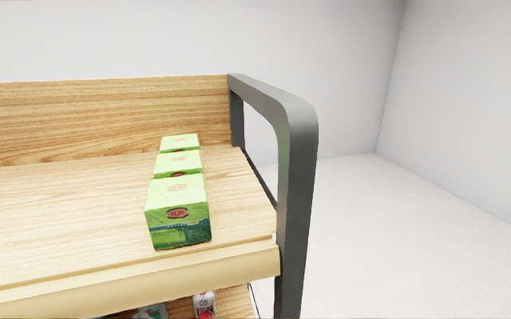

# 04｜Stage 3：让模型自己走，再把失败算清楚

同学们，Stage 3 最容易犯的错误，是拿 A* 控制器的成功轨迹冒充模型成绩。本轮严格分开：控制器只负责 Stage 1 采样；这里的每个动作都来自 StreamVLN `generate`，然后通过本机适配层送回 GenieSim。

## 闭环到底怎样运行

每条 episode 都按下面顺序执行：

1. 用固定 seed 重置到 held-out 起点，同时清空 KV cache、动作队列和历史记忆。
2. 读取 GenieSim 返回的 RGB、depth、4×4 pose 和指令。
3. StreamVLN 真实 `generate` 最多生成 4 个动作；非法输出安全转为 STOP。
4. 动作送回 `127.0.0.1:5802`，Isaac 主线程执行并等待至少两个渲染帧。
5. head-depth 安全门可能拒绝危险前进；拒绝时位姿不变，碰撞尝试进入统计。
6. STOP、到达终点或 200 步上限时结束；10 条成功和失败全部汇总。

公开 StreamVLN 首帧会请求 memory token，本项目在没有历史帧时复用当前已编码视觉特征作为一帧 memory。这是明确记录的非官方兼容 shim，不宣称课程原样实现。

## 同一批 10 条的最终成绩

唯一指标源是 [`eval_result.json`](../experiments/exp02-equivalent-v3/eval_result.json)，held-out ID 均为 `eval-2001…2010`，顺序完全一致。

| 指标 | StreamVLN base | 新 LoRA |
| --- | ---: | ---: |
| success@0.5m | 0/10 | 0/10 |
| success@3m | 2/10 | 1/10 |
| oracle success@0.5m | 0/10 | 0/10 |
| oracle success@3m | 3/10 | 1/10 |
| SPL@0.5m | 0.0000 | 0.0000 |
| SPL@3m | 0.0748 | 0.0665 |
| 平均最终距离 | 3.989m | 4.686m |
| 平均最小距离 | 2.884m | 3.482m |
| 平均路径长度 | 9.675m | 5.500m |
| 平均步数 | 133.9 | 53.2 |
| 近障碍/边界碰撞尝试 | 132 | 45 |

## 怎么读这个结果

LoRA 的平均步数、路径和碰撞尝试都更少，但 3m 成功、oracle success、最终距离和最小距离反而更差。换句话说，它更早停或更少探索，却没有更接近目标。不能只挑“碰撞少”这一项说 LoRA 更好。

训练轨迹的末端画面中，红色目标在不少视角里并不清晰，说明目标可见性和训练监督仍是主要数据问题。base 也会长时间原地调整或向错误方向探索；head-depth 安全门阻止了穿越货架，却不能替代视觉目标识别和停止决策。

真实 10 秒回放：[stage3-base-2004.gif](../assets/media/v3/stage3-base-2004.gif)；1080p/30fps 无声片段：[MP4](../assets/media/v3/stage3-base-2004.mp4)。

## 本阶段结论

真正的 StreamVLN base/LoRA → GenieSim 闭环和同集 10 条评测已经完成；但按预设 0.5m 成功标准，两个模型都是 **0/10**。因此本轮对外只能称“非官方等价适配失败复盘”，不能称模型导航成功案例，也不向 AgiBot Open Session 榜单提交。
